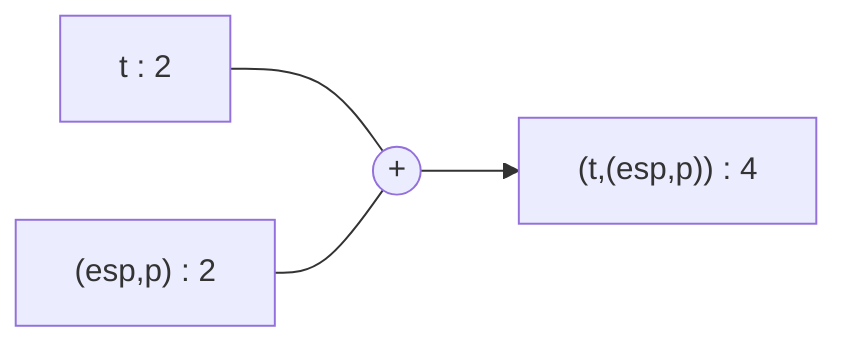
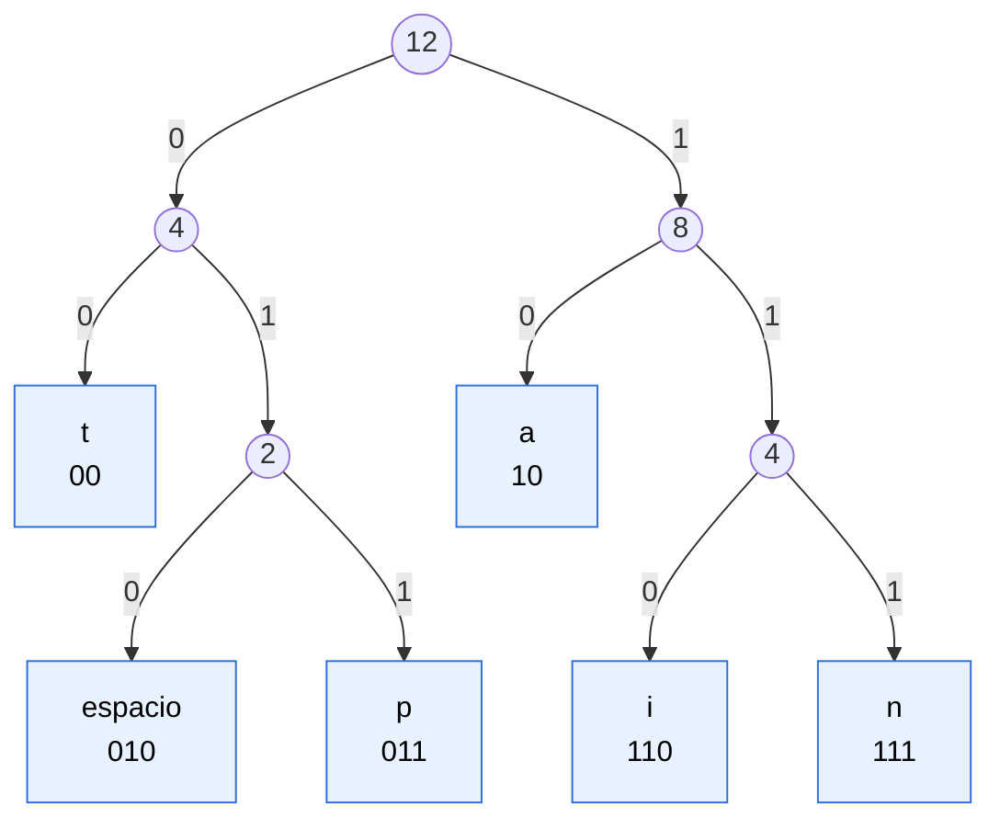
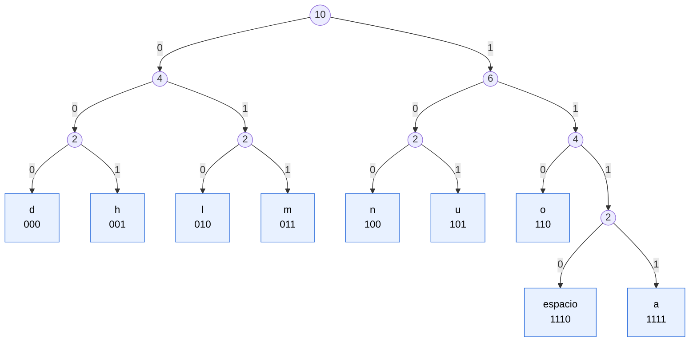
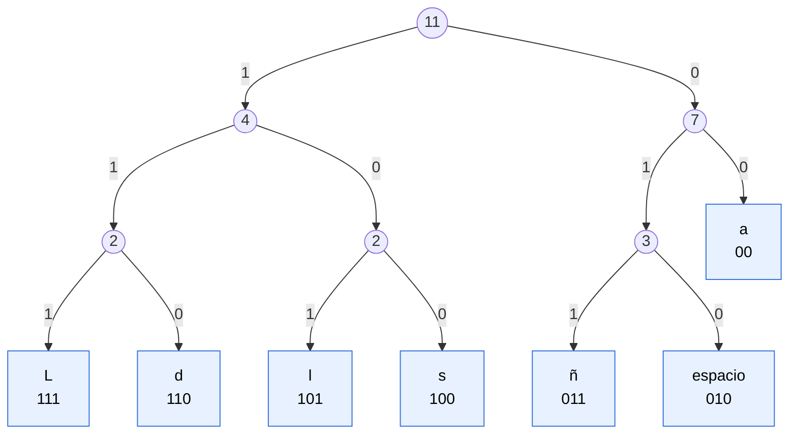
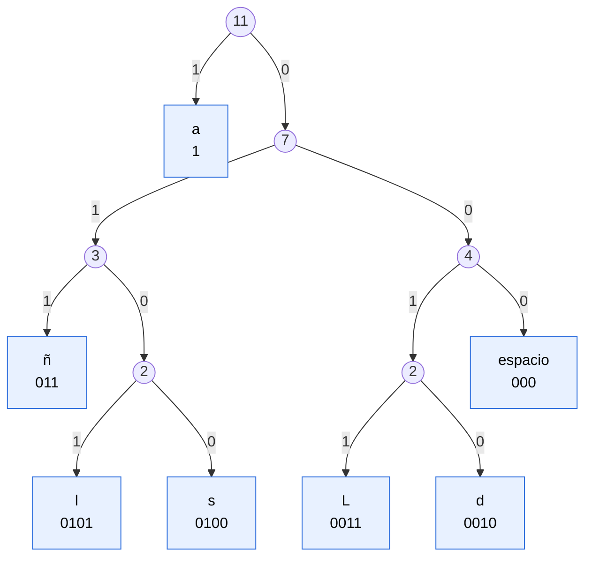

# 02 · Cómo se "suman" los árboles

[← Volver al índice](../README.md) · Anterior: [01 Fundamentos y reglas](01-fundamentos-y-reglas.md) · Siguiente: [03 Compresión y descompresión](03-compresion-y-descompresion.md)

Esta es la parte que más puntos da en el examen y donde más se equivoca la gente. Aquí se explica con calma **qué se suma, cuándo, dónde se coloca el resultado y cómo comprobar que está bien**.

## Contenido

1. [La idea en una frase](#1-la-idea-en-una-frase)
2. [Un paso de suma, en 6 movimientos](#2-un-paso-de-suma-en-6-movimientos)
3. [Ejemplo completo: "anita patina"](#3-ejemplo-completo-anita-patina)
4. [Los tres tipos de empate](#4-los-tres-tipos-de-empate)
5. [Segundo ejemplo: "hola mundo"](#5-segundo-ejemplo-hola-mundo-muchos-pesos-iguales)
6. [Tercer ejemplo: Test III (AS dado y 1 = izquierda)](#6-tercer-ejemplo-test-iii-as-dado-y-1--izquierda)
7. [Qué pasa si insertas el nodo en el lugar equivocado](#7-qué-pasa-si-insertas-el-nodo-en-el-lugar-equivocado)
8. [Las sumas de control](#8-las-sumas-de-control-cómo-saber-que-está-bien)
9. [Las demás sumas del ejercicio](#9-las-demás-sumas-del-ejercicio-de-bits-a-bytes-y-al-factor)
10. [Plantilla para hacerlo en papel](#10-plantilla-para-hacerlo-en-papel)
11. [Errores típicos al sumar](#11-errores-típicos-al-sumar)
12. [Ejercicios de práctica](#12-ejercicios-de-práctica)

---

## 1. La idea en una frase

> Cada carácter empieza como un **árbol de un solo nodo** cuyo peso es su frecuencia. Se **suman de a dos los dos árboles más livianos** (el resultado es un árbol nuevo que pesa la suma) hasta que queda **un solo árbol**: el árbol de Huffman.

Por eso se habla de "sumar árboles": no se suman letras, se suman **pesos** de árboles y, al sumarlos, se **pegan** bajo un nodo padre nuevo.



El nodo padre no guarda ningún carácter. Solo guarda **el peso total de todo lo que cuelga de él**.

## 2. Un paso de suma, en 6 movimientos

Cada vez que sumas, haces siempre lo mismo. Repítelo como una receta:

| # | Movimiento | Qué haces exactamente |
| --- | --- | --- |
| 1 | **Mirar** | Escribe la lista ordenada de menor a mayor peso (y, entre pesos iguales, por ASCII al principio). |
| 2 | **Sacar** | Quita los **dos primeros** de la lista: el primero se llama A y el segundo B. |
| 3 | **Sumar** | Calcula `peso(A) + peso(B)`. |
| 4 | **Dibujar** | Dibuja un nodo nuevo con **A a la izquierda** y **B a la derecha**. |
| 5 | **Colocar** | Recorre la lista restante **de izquierda a derecha**. Pasa por encima de **todos los que pesen menos o lo mismo** que el nodo nuevo. Ponlo justo ahí, o sea **después de los iguales**. |
| 6 | **Reescribir** | Escribe la lista completa como queda. La lista ahora tiene **un elemento menos**. |

**Se termina** cuando la lista tiene un solo elemento. Ese es la **raíz**.

**Regla del dedo.** Pon el dedo sobre el primer elemento de la lista restante. Mientras ese elemento pese **menos o igual** que la suma, avanza el dedo. Cuando el elemento bajo el dedo pese **más** que la suma (o ya no haya más), el nodo nuevo se coloca **justo antes del dedo**.

**Cuántos pasos hay.** Si hay *H* hojas (caracteres distintos), la lista pierde un elemento por paso, así que hay exactamente **H − 1 sumas**. Cada suma crea un nodo interno, por eso `NT = H − 1`.

## 3. Ejemplo completo: "anita patina"

Texto de 12 caracteres (el espacio cuenta).

**Paso A. Frecuencias, ASCII y lista inicial.** Se ordena por frecuencia y, si empatan, por ASCII (espacio = 32, p = 112, i = 105, n = 110, t = 116, a = 97):

`esp:1, p:1, i:2, n:2, t:2, a:4`

Lectura de la lista: `esp:1` significa "espacio con peso 1". Los dos de peso 1 son espacio (32) y p (112); luego los de peso 2 son i (105), n (110), t (116); al final está a (peso 4).

**Paso B. Las 5 sumas.**

| Paso | Se unen (1.º a la izquierda, 2.º a la derecha) | Suma | Dónde se inserta el nodo nuevo | Lista que queda |
| --- | --- | --- | --- | --- |
| 1 | `esp:1` + `p:1` | 1 + 1 = 2 | después de `t:2` (pesa lo mismo, 2) | `i:2, n:2, t:2, (esp,p):2, a:4` |
| 2 | `i:2` + `n:2` | 2 + 2 = 4 | después de `a:4` (pesa lo mismo, 4) | `t:2, (esp,p):2, a:4, (i,n):4` |
| 3 | `t:2` + `(esp,p):2` | 2 + 2 = 4 | después de `(i,n):4` (pesa lo mismo, 4) | `a:4, (i,n):4, (t,(esp,p)):4` |
| 4 | `a:4` + `(i,n):4` | 4 + 4 = 8 | al final | `(t,(esp,p)):4, (a,(i,n)):8` |
| 5 | `(t,(esp,p)):4` + `(a,(i,n)):8` | 4 + 8 = 12 | queda solo: es la raíz | `((t,(esp,p)),(a,(i,n))):12` |

Cómo se leen los cinco pasos con la regla del dedo:

1. **Paso 1.** Los dos primeros son `esp:1` y `p:1`. Suman 2. En la lista que queda (`i:2, n:2, t:2, a:4`) el dedo avanza sobre `i:2`, `n:2` y `t:2` porque pesan lo mismo (2), y se detiene en `a:4` porque pesa más. El nodo nuevo va **entre `t:2` y `a:4`**.
2. **Paso 2.** Los dos primeros son `i:2` y `n:2`. Suman 4. En la lista que queda (`t:2, (esp,p):2, a:4`) el dedo pasa los de peso 2 y también `a:4` porque 4 es igual a la suma. El nodo nuevo va **después de `a:4`**, al final.
3. **Paso 3.** Los dos primeros son `t:2` y `(esp,p):2`. Suman 4. Quedan `a:4` y `(i,n):4`, ambos de peso 4: el nodo nuevo va **después de los dos**.
4. **Paso 4.** Salen `a:4` y `(i,n):4` (el primero de los tres de peso 4 es `a`, por eso se une con `(i,n)` y no con `(t,(esp,p))`). Suman 8.
5. **Paso 5.** Quedan solo dos: `(t,(esp,p)):4` y `(a,(i,n)):8`. Suman 12 y esa es la **raíz**.

**Paso C. El árbol.** Izquierda = 0 y derecha = 1:



**Paso D. Tabla con los códigos y los bits.**

| Carácter | TF | ASCII | CH | Bits (TF × largo) |
| --- | --- | --- | --- | --- |
| a | 4 | 97 | `10` | 8 |
| i | 2 | 105 | `110` | 6 |
| n | 2 | 110 | `111` | 6 |
| t | 2 | 116 | `00` | 4 |
| espacio | 1 | 32 | `010` | 3 |
| p | 1 | 112 | `011` | 3 |
| **Total** | **12** | | | **30 bits** |

## 4. Los tres tipos de empate

Los empates son la trampa del ejercicio. Hay tres y cada uno se resuelve distinto.

| Empate | Se resuelve así | Dónde se ve |
| --- | --- | --- |
| **Hoja contra hoja** (mismo peso) | Por **ASCII**, de menor a mayor. | Lista inicial: `esp:1` antes que `p:1` (32 < 112). |
| **Nodo nuevo contra lo que ya está** (mismo peso) | El nodo nuevo va **después** de todos. | Paso 2 de "anita patina": `(i,n):4` va después de `a:4`. |
| **Nodo contra nodo** (mismo peso) | El **más viejo** sale primero. | Pasos 3 y 4: `a:4` es más viejo que `(i,n):4`, que a su vez es más viejo que `(t,(esp,p)):4`. |

Resumen en una frase: **entre pesos iguales sale primero el que lleva más tiempo en la lista, y los caracteres originales se ordenan por ASCII.** Los nodos nuevos no tienen ASCII, así que nunca se desempatan por ASCII: simplemente se ponen al final del grupo.

> El ASCII solo se usa **una vez**: para ordenar la lista inicial. Después, el orden lo define la regla "el nodo nuevo va después de los iguales".

## 5. Segundo ejemplo: "hola mundo" (muchos pesos iguales)

Este ejemplo tiene ocho caracteres con peso 1 (más la `o` con peso 2). Sirve para ver cómo se encadenan los empates. Lista inicial (por ASCII: espacio 32, a 97, d 100, h 104, l 108, m 109, n 110, u 117, o 111 va con peso 2):

`esp:1, a:1, d:1, h:1, l:1, m:1, n:1, u:1, o:2`

| Paso | Se unen (1.º a la izquierda, 2.º a la derecha) | Suma | Dónde se inserta el nodo nuevo | Lista que queda |
| --- | --- | --- | --- | --- |
| 1 | `esp:1` + `a:1` | 1 + 1 = 2 | después de `o:2` (pesa lo mismo, 2) | `d:1, h:1, l:1, m:1, n:1, u:1, o:2, (esp,a):2` |
| 2 | `d:1` + `h:1` | 1 + 1 = 2 | después de `(esp,a):2` (pesa lo mismo, 2) | `l:1, m:1, n:1, u:1, o:2, (esp,a):2, (d,h):2` |
| 3 | `l:1` + `m:1` | 1 + 1 = 2 | después de `(d,h):2` (pesa lo mismo, 2) | `n:1, u:1, o:2, (esp,a):2, (d,h):2, (l,m):2` |
| 4 | `n:1` + `u:1` | 1 + 1 = 2 | después de `(l,m):2` (pesa lo mismo, 2) | `o:2, (esp,a):2, (d,h):2, (l,m):2, (n,u):2` |
| 5 | `o:2` + `(esp,a):2` | 2 + 2 = 4 | al final | `(d,h):2, (l,m):2, (n,u):2, (o,(esp,a)):4` |
| 6 | `(d,h):2` + `(l,m):2` | 2 + 2 = 4 | después de `(o,(esp,a)):4` (pesa lo mismo, 4) | `(n,u):2, (o,(esp,a)):4, ((d,h),(l,m)):4` |
| 7 | `(n,u):2` + `(o,(esp,a)):4` | 2 + 4 = 6 | al final | `((d,h),(l,m)):4, ((n,u),(o,(esp,a))):6` |
| 8 | `((d,h),(l,m)):4` + `((n,u),(o,(esp,a))):6` | 4 + 6 = 10 | queda solo: es la raíz | `(((d,h),(l,m)),((n,u),(o,(esp,a)))):10` |

Observa estos tres puntos:

- **Pasos 1 a 4.** Los pesos 1 se van sumando de a dos, y cada nodo nuevo de peso 2 se coloca **detrás de la `o:2`** y detrás de los nodos de peso 2 que ya existían. Por eso `o:2` se une primero (paso 5): es el más viejo de los de peso 2.
- **Paso 5.** `o:2` + `(esp,a):2` = 4. Los demás pesan 2, así que el nodo nuevo va **al final**.
- **Paso 6.** `(d,h):2` + `(l,m):2` = 4. Ya existe un nodo de peso 4 en la lista, así que el nuevo va **detrás de él**.
- **Pasos 7 y 8.** Las sumas 6 y 10 son mayores que todo lo que queda, así que van al final; el paso 8 deja un solo nodo, la raíz.

Árbol resultante:



| Carácter | TF | ASCII | CH | Bits (TF × largo) |
| --- | --- | --- | --- | --- |
| o | 2 | 111 | `110` | 6 |
| espacio | 1 | 32 | `1110` | 4 |
| a | 1 | 97 | `1111` | 4 |
| d | 1 | 100 | `000` | 3 |
| h | 1 | 104 | `001` | 3 |
| l | 1 | 108 | `010` | 3 |
| m | 1 | 109 | `011` | 3 |
| n | 1 | 110 | `100` | 3 |
| u | 1 | 117 | `101` | 3 |
| **Total** | **10** | | | **32 bits** |

## 6. Tercer ejemplo: Test III (AS dado y 1 = izquierda)

En este enunciado hay **dos cambios** respecto a los otros ejemplos:

1. Dan una **columna AS propia** (L = 100, d = 101, l = 102, s = 103, ñ = 104, espacio = 105, a = 106). El desempate por ASCII se hace con **esa** columna, no con el ASCII real.
2. Piden **1 por las ramas izquierdas y 0 por las ramas derechas**.

La suma del árbol es idéntica; lo único que cambia es el bit que escribes en cada rama. La oración es `L a a a a ␣ ␣ s l d ñ`. Lista inicial:

`L:1, d:1, l:1, s:1, ñ:1, esp:2, a:4`

| Paso | Se unen (1.º a la izquierda, 2.º a la derecha) | Suma | Dónde se inserta el nodo nuevo | Lista que queda |
| --- | --- | --- | --- | --- |
| 1 | `L:1` + `d:1` | 1 + 1 = 2 | después de `esp:2` (pesa lo mismo, 2) | `l:1, s:1, ñ:1, esp:2, (L,d):2, a:4` |
| 2 | `l:1` + `s:1` | 1 + 1 = 2 | después de `(L,d):2` (pesa lo mismo, 2) | `ñ:1, esp:2, (L,d):2, (l,s):2, a:4` |
| 3 | `ñ:1` + `esp:2` | 1 + 2 = 3 | después de `(l,s):2` y antes de `a:4` | `(L,d):2, (l,s):2, (ñ,esp):3, a:4` |
| 4 | `(L,d):2` + `(l,s):2` | 2 + 2 = 4 | después de `a:4` (pesa lo mismo, 4) | `(ñ,esp):3, a:4, ((L,d),(l,s)):4` |
| 5 | `(ñ,esp):3` + `a:4` | 3 + 4 = 7 | al final | `((L,d),(l,s)):4, ((ñ,esp),a):7` |
| 6 | `((L,d),(l,s)):4` + `((ñ,esp),a):7` | 4 + 7 = 11 | queda solo: es la raíz | `(((L,d),(l,s)),((ñ,esp),a)):11` |

Nota el paso 3: `ñ:1 + esp:2 = 3`. El 3 es **mayor** que los dos `2`, así que se coloca después de ellos, y es **menor** que `a:4`, así que queda **antes** de `a`. Es el único paso en el que la suma queda "en medio" de la lista.



| Carácter | TF | AS (dado) | CH | Bits (TF × largo) |
| --- | --- | --- | --- | --- |
| a | 4 | 106 | `00` | 8 |
| espacio | 2 | 105 | `010` | 6 |
| L | 1 | 100 | `111` | 3 |
| d | 1 | 101 | `110` | 3 |
| l | 1 | 102 | `101` | 3 |
| s | 1 | 103 | `100` | 3 |
| ñ | 1 | 104 | `011` | 3 |
| **Total** | **11** | | | **29 bits** |

## 7. Qué pasa si insertas el nodo en el lugar equivocado

Cuando insertas el nodo nuevo **antes** de los iguales en vez de **después**, el árbol cambia aunque el total de bits sea el mismo. Con el Test III la diferencia aparece ya en el **paso 1**: el nodo `(L,d):2` se pone antes de `esp:2` en lugar de después, y esa pequeña diferencia se arrastra hasta el final.

Sumas con el orden **incorrecto** (nodo nuevo antes de los iguales). Compárala con la tabla de la sección 6:

| Paso | Se unen (1.º a la izquierda, 2.º a la derecha) | Suma | Dónde se inserta el nodo nuevo | Lista que queda |
| --- | --- | --- | --- | --- |
| 1 | `L:1` + `d:1` | 1 + 1 = 2 | antes de `esp:2` (pesa lo mismo, 2) | `l:1, s:1, ñ:1, (L,d):2, esp:2, a:4` |
| 2 | `l:1` + `s:1` | 1 + 1 = 2 | antes de `(L,d):2` (pesa lo mismo, 2) | `ñ:1, (l,s):2, (L,d):2, esp:2, a:4` |
| 3 | `ñ:1` + `(l,s):2` | 1 + 2 = 3 | después de `esp:2` y antes de `a:4` | `(L,d):2, esp:2, (ñ,(l,s)):3, a:4` |
| 4 | `(L,d):2` + `esp:2` | 2 + 2 = 4 | antes de `a:4` (pesa lo mismo, 4) | `(ñ,(l,s)):3, ((L,d),esp):4, a:4` |
| 5 | `(ñ,(l,s)):3` + `((L,d),esp):4` | 3 + 4 = 7 | al final | `a:4, ((ñ,(l,s)),((L,d),esp)):7` |
| 6 | `a:4` + `((ñ,(l,s)),((L,d),esp)):7` | 4 + 7 = 11 | queda solo: es la raíz | `(a,((ñ,(l,s)),((L,d),esp))):11` |

Árbol **incorrecto** que resulta:



Es válido como árbol de Huffman (suma también 29 bits), pero **no es el que sale con el criterio del profesor** y en el examen la tabla de códigos saldría mal:

| Carácter | Correcto (después de los iguales) | Incorrecto (antes de los iguales) |
| --- | --- | --- |
| a | `00` | `1` |
| espacio | `010` | `000` |
| ñ | `011` | `011` |
| L, d, l, s | `111`, `110`, `101`, `100` | `0011`, `0010`, `0101`, `0100` |

**Por qué existe esta regla.** Poner el nodo nuevo después de los iguales da un árbol **más equilibrado**: aquí el código más largo mide 3 bits en vez de 4. Es el criterio que usa el profesor, así que es el único que vale en el examen.

## 8. Las sumas de control: cómo saber que está bien

Antes de seguir, comprueba tu ejercicio con estas **cinco sumas**. Si alguna falla, hay un error en el árbol.

| # | Comprobación | Ejemplo "anita patina" |
| --- | --- | --- |
| 1 | **El peso de la raíz es el largo del texto.** | 12 caracteres, raíz 12. |
| 2 | **La suma de los pesos de todos los nodos internos es el total de bits.** | 2 + 4 + 4 + 8 + 12 = **30** |
| 3 | **La suma de la columna Bits (TF × largo del código) da lo mismo.** | 8 + 6 + 6 + 4 + 3 + 3 = **30** |
| 4 | **Nodos internos = hojas − 1.** | 6 hojas, 5 nodos internos (NT = 5). |
| 5 | **Total de nodos = 2 × hojas − 1.** | 2 × 6 − 1 = 11 nodos. |

Pesos de los nodos internos, en el orden en que se crearon: `2 + 4 + 4 + 8 + 12` = **30**.

Suma de la columna Bits (TF × largo): **30**. Las dos sumas dan lo mismo.

**¿Por qué la suma 2 da el total de bits?** Un carácter con código de longitud *L* cuelga de *L* nodos internos (todos sus antepasados hasta la raíz). Cada uno de esos nodos "cuenta" una vez a ese carácter en su peso. Entonces, al sumar los pesos de todos los internos, cada carácter se cuenta tantas veces como su código es largo, o sea **TF × L**. La suma de todos los TF × L es justo el total de bits.

Es un atajo muy útil: **calculas los bits totales directamente con las sumas del árbol, sin esperar a tener los códigos.** Para "hola mundo": Pesos de los nodos internos, en el orden en que se crearon: `2 + 2 + 2 + 2 + 4 + 4 + 6 + 10` = **32**.

Suma de la columna Bits (TF × largo): **32**. Las dos sumas dan lo mismo.

## 9. Las demás sumas del ejercicio: de bits a bytes y al factor

Después del árbol, el ejercicio sigue con más aritmética. Todas con "anita patina":

| Cálculo | Operación | Resultado |
| --- | --- | --- |
| Bits originales | 12 caracteres × 8 | 96 bits = 12 bytes |
| Bits comprimidos | suma de la columna Bits | 30 bits |
| Bytes completos | 30 ÷ 8 | 3 bytes |
| Bits sobrantes | 30 mod 8 | 6 bits (esto es **BS**) |
| Bytes del ZIP | 3 + 1 (porque sobran bits) | **4 bytes** |
| Relleno | 8 − 6 | 2 ceros al final |
| **Factor de compresión** | 4 ÷ 12 | **33,3 %** |
| Celdas del tree | (5 + 6) nodos × 2 celdas | **22** (el `5 + 6 = 11 × 2 = 22` del tablero) |
| Tamaño del archivo | 1 (NT) + 22 (tree) + 1 (BS) + 4 (ZIP) | **28 bytes** |

La suma del tablero `5 + 6 = 11 × 2 = 22` significa: 5 nodos internos + 6 hojas = 11 nodos, y cada nodo ocupa 2 celdas en el tree. En fórmula: **celdas = (2·NT + 1) × 2 = 4·NT + 2**.

## 10. Plantilla para hacerlo en papel

Copia este esquema en tu hoja del examen y complétalo:

```
TEXTO: ______________________   (largo: ____)

1) FRECUENCIAS            TF   ASCII
   ______                 __   ___
   ______                 __   ___

2) LISTA INICIAL (menor a mayor TF, empate por ASCII)
   lst -> ____, ____, ____, ____

3) SUMAS (primero a la izq, segundo a la der; nuevo DESPUÉS de los iguales)
   paso 1:  ___ + ___ = ___   lst -> ____________________
   paso 2:  ___ + ___ = ___   lst -> ____________________
   ...
   (H - 1 pasos; el último deja un solo nodo = raíz = largo del texto)

4) CÓDIGOS (raíz -> hoja; izq=__  der=__)
   ____ = ___   ____ = ___   ...

5) COMPROBACIÓN:  suma de pesos internos = ___ = suma de la columna Bits
```

## 11. Errores típicos al sumar

1. **Unir los dos primeros de la lista inicial sin volver a ordenar.** Después de cada suma hay que reescribir la lista con el nodo nuevo en su lugar.
2. **Poner el nodo nuevo antes de los iguales.** Va **después**.
3. **Desempatar nodos nuevos por ASCII.** Los nodos nuevos no tienen ASCII. Solo se ordena por ASCII la lista inicial.
4. **Poner el primero a la derecha.** El primero de la lista va a la **izquierda**.
5. **Olvidar que la suma puede quedar en medio de la lista** (como `(ñ,esp):3` entre los de peso 2 y `a:4`).
6. **No hacer la suma de control.** El peso de la raíz debe ser el largo del texto: si no lo es, se perdió o se repitió un carácter.
7. **Contar mal el texto.** El espacio y el salto de línea final cuentan como caracteres; `A` y `a` son distintos.
8. **Usar el ASCII real cuando el enunciado da su propia columna AS.** Manda la columna del enunciado.

## 12. Ejercicios de práctica

Resuélvelos en papel con la plantilla de la sección 10 y comprueba con las respuestas (despliega cada una).

**E1.** `ababcabc` (códigos con 0 = izquierda).

<details>
<summary>Ver solución E1</summary>

Lista inicial: `c:2, a:3, b:3`

| Paso | Se unen (1.º a la izquierda, 2.º a la derecha) | Suma | Dónde se inserta el nodo nuevo | Lista que queda |
| --- | --- | --- | --- | --- |
| 1 | `c:2` + `a:3` | 2 + 3 = 5 | al final | `b:3, (c,a):5` |
| 2 | `b:3` + `(c,a):5` | 3 + 5 = 8 | queda solo: es la raíz | `(b,(c,a)):8` |

| Carácter | TF | ASCII | CH | Bits (TF × largo) |
| --- | --- | --- | --- | --- |
| a | 3 | 97 | `11` | 6 |
| b | 3 | 98 | `0` | 3 |
| c | 2 | 99 | `10` | 4 |
| **Total** | **8** | | | **13 bits** |

Pesos de los nodos internos, en el orden en que se crearon: `5 + 8` = **13**.

Suma de la columna Bits (TF × largo): **13**. Las dos sumas dan lo mismo.

</details>

**E2.** `mississippi` (0 = izquierda).

<details>
<summary>Ver solución E2</summary>

Lista inicial: `m:1, p:2, i:4, s:4`

| Paso | Se unen (1.º a la izquierda, 2.º a la derecha) | Suma | Dónde se inserta el nodo nuevo | Lista que queda |
| --- | --- | --- | --- | --- |
| 1 | `m:1` + `p:2` | 1 + 2 = 3 | al inicio (todos los demás pesan más) | `(m,p):3, i:4, s:4` |
| 2 | `(m,p):3` + `i:4` | 3 + 4 = 7 | al final | `s:4, ((m,p),i):7` |
| 3 | `s:4` + `((m,p),i):7` | 4 + 7 = 11 | queda solo: es la raíz | `(s,((m,p),i)):11` |

| Carácter | TF | ASCII | CH | Bits (TF × largo) |
| --- | --- | --- | --- | --- |
| i | 4 | 105 | `11` | 8 |
| s | 4 | 115 | `0` | 4 |
| p | 2 | 112 | `101` | 6 |
| m | 1 | 109 | `100` | 3 |
| **Total** | **11** | | | **21 bits** |

Pesos de los nodos internos, en el orden en que se crearon: `3 + 7 + 11` = **21**.

Suma de la columna Bits (TF × largo): **21**. Las dos sumas dan lo mismo.

</details>

**E3.** `tres tristes tigres` (0 = izquierda). Fíjate en los empates entre nodos.

<details>
<summary>Ver solución E3</summary>

Lista inicial: `g:1, esp:2, i:2, e:3, r:3, s:4, t:4`

| Paso | Se unen (1.º a la izquierda, 2.º a la derecha) | Suma | Dónde se inserta el nodo nuevo | Lista que queda |
| --- | --- | --- | --- | --- |
| 1 | `g:1` + `esp:2` | 1 + 2 = 3 | después de `r:3` (pesa lo mismo, 3) | `i:2, e:3, r:3, (g,esp):3, s:4, t:4` |
| 2 | `i:2` + `e:3` | 2 + 3 = 5 | al final | `r:3, (g,esp):3, s:4, t:4, (i,e):5` |
| 3 | `r:3` + `(g,esp):3` | 3 + 3 = 6 | al final | `s:4, t:4, (i,e):5, (r,(g,esp)):6` |
| 4 | `s:4` + `t:4` | 4 + 4 = 8 | al final | `(i,e):5, (r,(g,esp)):6, (s,t):8` |
| 5 | `(i,e):5` + `(r,(g,esp)):6` | 5 + 6 = 11 | al final | `(s,t):8, ((i,e),(r,(g,esp))):11` |
| 6 | `(s,t):8` + `((i,e),(r,(g,esp))):11` | 8 + 11 = 19 | queda solo: es la raíz | `((s,t),((i,e),(r,(g,esp)))):19` |

| Carácter | TF | ASCII | CH | Bits (TF × largo) |
| --- | --- | --- | --- | --- |
| s | 4 | 115 | `00` | 8 |
| t | 4 | 116 | `01` | 8 |
| e | 3 | 101 | `101` | 9 |
| r | 3 | 114 | `110` | 9 |
| espacio | 2 | 32 | `1111` | 8 |
| i | 2 | 105 | `100` | 6 |
| g | 1 | 103 | `1110` | 4 |
| **Total** | **19** | | | **52 bits** |

Pesos de los nodos internos, en el orden en que se crearon: `3 + 5 + 6 + 8 + 11 + 19` = **52**.

Suma de la columna Bits (TF × largo): **52**. Las dos sumas dan lo mismo.

</details>

**E4.** `abracadabra` con **1 = izquierda y 0 = derecha**.

<details>
<summary>Ver solución E4</summary>

Lista inicial: `c:1, d:1, b:2, r:2, a:5`

| Paso | Se unen (1.º a la izquierda, 2.º a la derecha) | Suma | Dónde se inserta el nodo nuevo | Lista que queda |
| --- | --- | --- | --- | --- |
| 1 | `c:1` + `d:1` | 1 + 1 = 2 | después de `r:2` (pesa lo mismo, 2) | `b:2, r:2, (c,d):2, a:5` |
| 2 | `b:2` + `r:2` | 2 + 2 = 4 | después de `(c,d):2` y antes de `a:5` | `(c,d):2, (b,r):4, a:5` |
| 3 | `(c,d):2` + `(b,r):4` | 2 + 4 = 6 | al final | `a:5, ((c,d),(b,r)):6` |
| 4 | `a:5` + `((c,d),(b,r)):6` | 5 + 6 = 11 | queda solo: es la raíz | `(a,((c,d),(b,r))):11` |

| Carácter | TF | ASCII | CH | Bits (TF × largo) |
| --- | --- | --- | --- | --- |
| a | 5 | 97 | `1` | 5 |
| b | 2 | 98 | `001` | 6 |
| r | 2 | 114 | `000` | 6 |
| c | 1 | 99 | `011` | 3 |
| d | 1 | 100 | `010` | 3 |
| **Total** | **11** | | | **23 bits** |

Pesos de los nodos internos, en el orden en que se crearon: `2 + 4 + 6 + 11` = **23**.

Suma de la columna Bits (TF × largo): **23**. Las dos sumas dan lo mismo.

</details>

---

[← Volver al índice](../README.md) · Siguiente: [03 Compresión y descompresión](03-compresion-y-descompresion.md)
