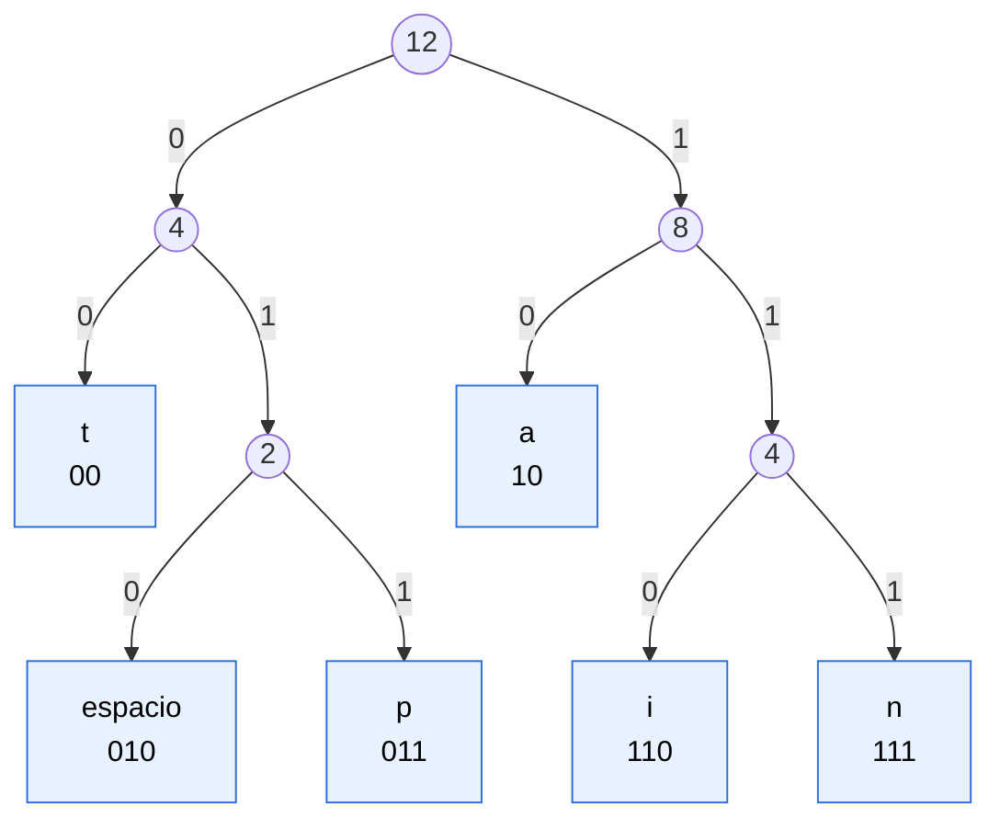
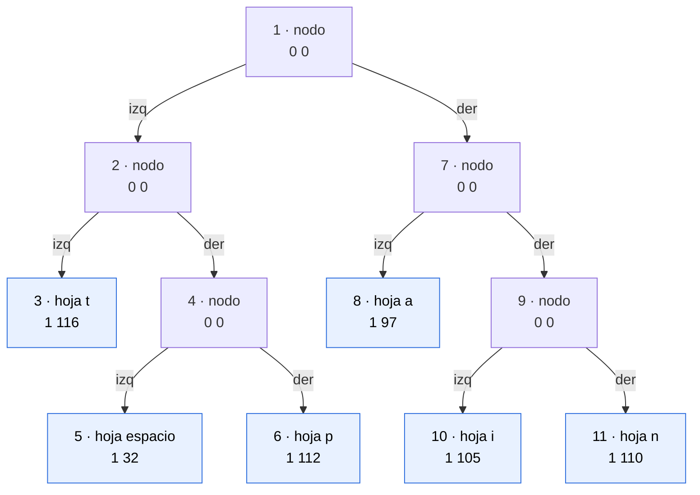
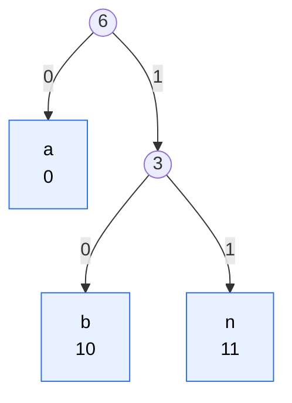
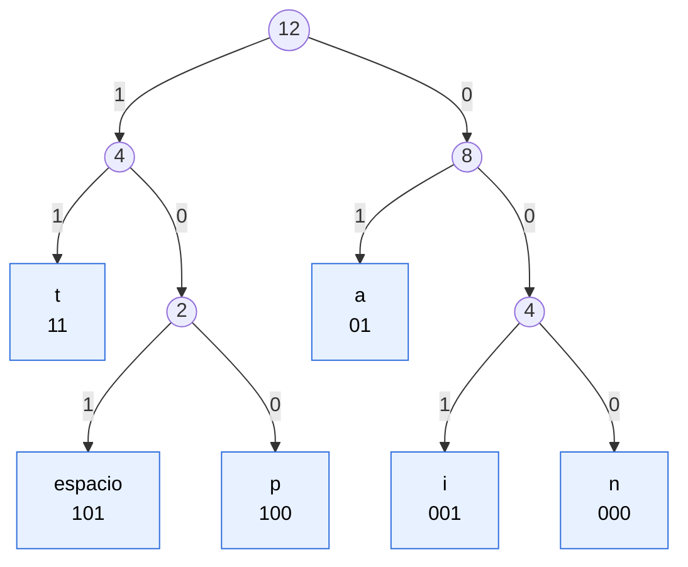
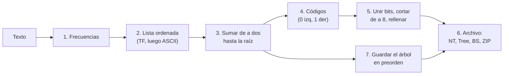

# 03 · Compresión y descompresión paso a paso

[← Volver al índice](../README.md) · Anterior: [02 Cómo se suman los árboles](02-suma-de-arboles.md) · Siguiente: [04 Guía del código](04-guia-del-codigo.md)

Este documento sigue el **orden del tablero del profesor**: frecuencias, lista, árbol, factor de compresión, sección ZIP, estructura del archivo y árbol guardado. Después se hace el camino inverso.

## Contenido

1. [Los 7 pasos de la compresión](#1-los-7-pasos-de-la-compresión)
2. [Ejemplo completo: "anita patina"](#2-ejemplo-completo-anita-patina)
3. [El campo Tree en detalle](#3-el-campo-tree-en-detalle)
4. [El campo BS en detalle](#4-el-campo-bs-en-detalle)
5. [Segundo ejemplo: "banana"](#5-segundo-ejemplo-banana)
6. [Descompresión paso a paso](#6-descompresión-paso-a-paso)
7. [Con la convención invertida (1 = izquierda)](#7-con-la-convención-invertida-1--izquierda)
8. [Resumen en un esquema](#8-resumen-en-un-esquema)

---

## 1. Los 7 pasos de la compresión

| # | Paso del tablero | Qué se hace |
| --- | --- | --- |
| 1 | **Tabla de frecuencias** | Cuenta cuántas veces aparece cada carácter (espacio incluido) y apunta su ASCII. Comprueba que la suma de las TF sea el largo del texto. |
| 2 | **Lista ordenada** | De menor a mayor TF; el empate se resuelve por ASCII. |
| 3 | **Árbol de Huffman** | Suma de a dos los dos primeros hasta quedar uno ([guía 02](02-suma-de-arboles.md)). |
| 4 | **Factor de compresión** | Códigos, total de bits, bytes comprimidos y comparación con los bytes originales. |
| 5 | **Sección ZIP** | Escribe el texto con su código debajo, junta los bits, corta de a 8 y rellena con ceros al final. |
| 6 | **Estructura del archivo total** | `NT`, `Tree`, `BS` y `ZIP`. |
| 7 | **Árbol de Huffman guardado (Tree)** | Recorrido en preorden: `0 0` por nodo interno y `1 ASCII` por hoja. |

## 2. Ejemplo completo: "anita patina"

Texto: `anita patina` (12 caracteres, con el espacio).

### Pasos 1 y 2. Frecuencias y lista

Lista inicial: `esp:1, p:1, i:2, n:2, t:2, a:4`

### Paso 3. Árbol

Las cinco sumas están explicadas en detalle en la [guía 02](02-suma-de-arboles.md#3-ejemplo-completo-anita-patina). El resultado es:

| Paso | Se unen (1.º a la izquierda, 2.º a la derecha) | Suma | Dónde se inserta el nodo nuevo | Lista que queda |
| --- | --- | --- | --- | --- |
| 1 | `esp:1` + `p:1` | 1 + 1 = 2 | después de `t:2` (pesa lo mismo, 2) | `i:2, n:2, t:2, (esp,p):2, a:4` |
| 2 | `i:2` + `n:2` | 2 + 2 = 4 | después de `a:4` (pesa lo mismo, 4) | `t:2, (esp,p):2, a:4, (i,n):4` |
| 3 | `t:2` + `(esp,p):2` | 2 + 2 = 4 | después de `(i,n):4` (pesa lo mismo, 4) | `a:4, (i,n):4, (t,(esp,p)):4` |
| 4 | `a:4` + `(i,n):4` | 4 + 4 = 8 | al final | `(t,(esp,p)):4, (a,(i,n)):8` |
| 5 | `(t,(esp,p)):4` + `(a,(i,n)):8` | 4 + 8 = 12 | queda solo: es la raíz | `((t,(esp,p)),(a,(i,n))):12` |



### Paso 4. Códigos y factor de compresión

| Carácter | TF | ASCII | CH | Bits (TF × largo) |
| --- | --- | --- | --- | --- |
| a | 4 | 97 | `10` | 8 |
| i | 2 | 105 | `110` | 6 |
| n | 2 | 110 | `111` | 6 |
| t | 2 | 116 | `00` | 4 |
| espacio | 1 | 32 | `010` | 3 |
| p | 1 | 112 | `011` | 3 |
| **Total** | **12** | | | **30 bits** |

Pesos de los nodos internos, en el orden en que se crearon: `2 + 4 + 4 + 8 + 12` = **30**.

Suma de la columna Bits (TF × largo): **30**. Las dos sumas dan lo mismo.

- **Bytes originales:** 12 caracteres = 12 bytes (96 bits).
- **Bytes comprimidos:** 30 bits = 30 ÷ 8 = **3 bytes** y sobran **6 bits** (30 mod 8). Esos 6 bits necesitan un byte más: **4 bytes**.
- **Factor de compresión:** 4 ÷ 12 = **33,3 %**.

### Paso 5. Sección ZIP

| Carácter | a | n | i | t | a | esp | p | a | t | i | n | a |
| --- | --- | --- | --- | --- | --- | --- | --- | --- | --- | --- | --- | --- |
| Código | `10` | `111` | `110` | `00` | `10` | `010` | `011` | `10` | `00` | `110` | `111` | `10` |

Bits unidos: `101111100010010011100011011110` (30 bits)

| Byte | Bits | Decimal |
| --- | --- | --- |
| 1 | `10111110` | 190 |
| 2 | `00100100` | 36 |
| 3 | `11100011` | 227 |
| 4 | `011110` + `00` de relleno = `01111000` | 120 |

El corte de cada byte cae **en medio de los códigos** (el código de `i`, `110`, se parte entre el byte 1 y el byte 2). No se separan: se corta donde caiga el bit número 8.

### Paso 6. Estructura del archivo total

| Campo | Valor |
| --- | --- |
| NT (nodos internos) | 5 |
| Tree (preorden, 22 bytes = 4·NT + 2) | `0 0 0 0 1 116 0 0 1 32 1 112 0 0 1 97 0 0 1 105 1 110` |
| BS (bits válidos del último byte) | 6 |
| ZIP | `190, 36, 227, 120` |

Tamaño del archivo completo: 1 + 22 + 1 + 4 = **28 bytes**.

En el tablero:

```
 NT     Tree (22 celdas)                                      BS    ZIP
[ 5 ] [0 0 0 0 1 116 0 0 1 32 1 112 0 0 1 97 0 0 1 105 1 110] [ 6 ] [190|36|227|120]
```

### Paso 7. Árbol guardado (preorden)

Se detalla en la sección siguiente.

## 3. El campo Tree en detalle

### 3.1 Qué se guarda y por qué

Para descomprimir hace falta **la forma del árbol y qué carácter hay en cada hoja**. No hacen falta los pesos, porque solo sirven para armar el árbol, no para recorrerlo.

Cada nodo ocupa **2 celdas** (2 bytes en el programa):

| Nodo | Celdas | Significado |
| --- | --- | --- |
| **Interno** | `0 0` | La primera celda `0` dice "no es hoja". La segunda no se usa y vale 0. |
| **Hoja** | `1 ASCII` | La primera celda `1` dice "es hoja". La segunda es el ASCII del carácter. |

### 3.2 En qué orden se escriben (preorden)

**Preorden = nodo, luego todo su lado izquierdo, luego todo su lado derecho.** Los números del dibujo indican el orden en que se escribe cada nodo:



Leyendo de 1 a 11: `0 0` · `0 0` · `1 116` · `0 0` · `1 32` · `1 112` · `0 0` · `1 97` · `0 0` · `1 105` · `1 110`.

### 3.3 Pseudocódigo de ida y de vuelta

**Guardar** (compresión):

```
guardar(nodo):
    si nodo es hoja:
        escribir 1, ASCII del carácter
    si no:
        escribir 0, 0
        guardar(nodo.izquierdo)
        guardar(nodo.derecho)
```

**Reconstruir** (descompresión):

```
leer():
    tipo = leer celda ; dato = leer celda
    si tipo == 1: devolver una hoja con el carácter 'dato'
    si no:
        izq = leer()          # primero el lado izquierdo
        der = leer()          # luego el derecho
        devolver nodo interno con hijos izq y der
```

La primera llamada a `leer()` devuelve la raíz.

### 3.4 Para qué sirve NT

Un árbol con **NT nodos internos** tiene **NT + 1 hojas**, o sea **2·NT + 1 nodos**. Como cada nodo son 2 celdas, el Tree ocupa **(2·NT + 1) × 2 = 4·NT + 2 celdas**. Así el descompresor sabe cuántas celdas leer antes de llegar al campo BS.

En el tablero: `5 + 6 = 11` nodos, `11 × 2 = 22` celdas.

## 4. El campo BS en detalle

**BS** son los **bits válidos del último byte del ZIP**. El relleno son ceros, y algunos códigos también terminan en cero, así que sin BS no se podría distinguir un cero válido de uno de relleno.

| Bits comprimidos | Bytes de ZIP | Último byte | BS | Relleno |
| --- | --- | --- | --- | --- |
| 30 | 4 | 6 bits válidos + 2 de relleno | **6** | 2 |
| 9 | 2 | 1 bit válido + 7 de relleno | **1** | 7 |
| 16 | 2 | lleno | **8** | 0 |
| 23 | 3 | 7 bits válidos + 1 de relleno | **7** | 1 |

Fórmula: `BS = bits mod 8` y, **si da 0, BS = 8**. Cantidad de bits válidos en total = `(bytes del ZIP − 1) × 8 + BS`.

## 5. Segundo ejemplo: "banana"

Un ejemplo corto de 6 caracteres. Lista inicial: `b:1, n:2, a:3`

| Paso | Se unen (1.º a la izquierda, 2.º a la derecha) | Suma | Dónde se inserta el nodo nuevo | Lista que queda |
| --- | --- | --- | --- | --- |
| 1 | `b:1` + `n:2` | 1 + 2 = 3 | después de `a:3` (pesa lo mismo, 3) | `a:3, (b,n):3` |
| 2 | `a:3` + `(b,n):3` | 3 + 3 = 6 | queda solo: es la raíz | `(a,(b,n)):6` |



| Carácter | TF | ASCII | CH | Bits (TF × largo) |
| --- | --- | --- | --- | --- |
| a | 3 | 97 | `0` | 3 |
| n | 2 | 110 | `11` | 4 |
| b | 1 | 98 | `10` | 2 |
| **Total** | **6** | | | **9 bits** |

| Carácter | b | a | n | a | n | a |
| --- | --- | --- | --- | --- | --- | --- |
| Código | `10` | `0` | `11` | `0` | `11` | `0` |

Bits unidos: `100110110` (9 bits)

| Byte | Bits | Decimal |
| --- | --- | --- |
| 1 | `10011011` | 155 |
| 2 | `0` + `0000000` de relleno = `00000000` | 0 |

| Campo | Valor |
| --- | --- |
| NT (nodos internos) | 2 |
| Tree (preorden, 10 bytes = 4·NT + 2) | `0 0 1 97 0 0 1 98 1 110` |
| BS (bits válidos del último byte) | 1 |
| ZIP | `155, 0` |

Tamaño del archivo completo: 1 + 10 + 1 + 2 = **14 bytes**.

- **Factor:** 9 bits = 1 byte y sobra 1 bit → **2 bytes**. 2 ÷ 6 = **33,3 %**.
- **BS = 1:** solo el primer bit del segundo byte es válido.

## 6. Descompresión paso a paso

Se hace al revés y solo usa lo que hay en el archivo. Con el archivo de "anita patina":

`NT = 5` · `Tree = 0 0 0 0 1 116 0 0 1 32 1 112 0 0 1 97 0 0 1 105 1 110` · `BS = 6` · `ZIP = 190, 36, 227, 120`

| # | Paso | Qué se hace |
| --- | --- | --- |
| 1 | **Leer NT** | Vale 5: el árbol tiene 11 nodos y ocupa 22 celdas. |
| 2 | **Reconstruir el árbol** | Lee las celdas de a pares con `leer()` (sección 3.3). |
| 3 | **Leer BS** | Vale 6: en el último byte solo se usan 6 bits. |
| 4 | **Pasar el ZIP a bits** | Cada byte a 8 bits. |
| 5 | **Descartar el relleno** | En el último byte solo valen los primeros BS bits. Total = (4 − 1) × 8 + 6 = **30 bits**. |
| 6 | **Recorrer el árbol** | Desde la raíz: 0 a la izquierda, 1 a la derecha. Al llegar a una hoja, escribe el carácter y vuelve a la raíz. |

### Paso 2 en detalle: reconstruir el árbol

| Par leído | Qué crea | Dónde queda |
| --- | --- | --- |
| `0 0` | Nodo interno | Es la raíz |
| `0 0` | Nodo interno | Hijo izquierdo de la raíz |
| `1 116` | Hoja `t` | Hijo izquierdo del nodo anterior |
| `0 0` | Nodo interno | Hijo derecho del nodo (4) |
| `1 32` | Hoja espacio | Hijo izquierdo de ese nodo |
| `1 112` | Hoja `p` | Hijo derecho de ese nodo. Ya se completó todo el lado izquierdo de la raíz |
| `0 0` | Nodo interno | Hijo derecho de la raíz |
| `1 97` | Hoja `a` | Hijo izquierdo del nodo (8) |
| `0 0` | Nodo interno | Hijo derecho del nodo (8) |
| `1 105` | Hoja `i` | Hijo izquierdo |
| `1 110` | Hoja `n` | Hijo derecho. El árbol está completo |

### Pasos 4 y 5: de bytes a bits

| Byte | Binario | Qué se usa |
| --- | --- | --- |
| 190 | `10111110` | Los 8 bits |
| 36 | `00100100` | Los 8 bits |
| 227 | `11100011` | Los 8 bits |
| 120 | `01111000` | Solo `011110` (6 bits). Los `00` finales son relleno |

### Paso 6: recorrer el árbol

Bits válidos: `101111100010010011100011011110`

| Bits leídos | Camino desde la raíz | Carácter | Texto hasta ahora |
| --- | --- | --- | --- |
| `10` | der, izq | a | `a` |
| `111` | der, der, der | n | `an` |
| `110` | der, der, izq | i | `ani` |
| `00` | izq, izq | t | `anit` |
| `10` | der, izq | a | `anita` |
| `010` | izq, der, izq | espacio | `anita␣` |
| `011` | izq, der, der | p | `anita␣p` |
| `10` | der, izq | a | `anita␣pa` |
| `00` | izq, izq | t | `anita␣pat` |
| `110` | der, der, izq | i | `anita␣pati` |
| `111` | der, der, der | n | `anita␣patin` |
| `10` | der, izq | a | `anita␣patina` |

Resultado: **anita patina**. Los 30 bits se gastaron exactamente, así que el relleno nunca se interpreta.

## 7. Con la convención invertida (1 = izquierda)

Si el enunciado dice "1: por las ramas izquierdas y 0: por las ramas derechas", el árbol es el mismo pero cada código tiene los bits invertidos. Para "anita patina":

| Carácter | TF | ASCII | CH | Bits (TF × largo) |
| --- | --- | --- | --- | --- |
| a | 4 | 97 | `01` | 8 |
| i | 2 | 105 | `001` | 6 |
| n | 2 | 110 | `000` | 6 |
| t | 2 | 116 | `11` | 4 |
| espacio | 1 | 32 | `101` | 3 |
| p | 1 | 112 | `100` | 3 |
| **Total** | **12** | | | **30 bits** |



| Carácter | a | n | i | t | a | esp | p | a | t | i | n | a |
| --- | --- | --- | --- | --- | --- | --- | --- | --- | --- | --- | --- | --- |
| Código | `01` | `000` | `001` | `11` | `01` | `101` | `100` | `01` | `11` | `001` | `000` | `01` |

Bits unidos: `010000011101101100011100100001` (30 bits)

| Byte | Bits | Decimal |
| --- | --- | --- |
| 1 | `01000001` | 65 |
| 2 | `11011011` | 219 |
| 3 | `00011100` | 28 |
| 4 | `100001` + `00` de relleno = `10000100` | 132 |

| Campo | Valor |
| --- | --- |
| NT (nodos internos) | 5 |
| Tree (preorden, 22 bytes = 4·NT + 2) | `0 0 0 0 1 116 0 0 1 32 1 112 0 0 1 97 0 0 1 105 1 110` |
| BS (bits válidos del último byte) | 6 |
| ZIP | `65, 219, 28, 132` |

Tamaño del archivo completo: 1 + 22 + 1 + 4 = **28 bytes**.

Se comprueba con la descompresión (1 baja a la izquierda y 0 a la derecha):

| Bits leídos | Camino desde la raíz | Carácter | Texto hasta ahora |
| --- | --- | --- | --- |
| `01` | der, izq | a | `a` |
| `000` | der, der, der | n | `an` |
| `001` | der, der, izq | i | `ani` |
| `11` | izq, izq | t | `anit` |
| `01` | der, izq | a | `anita` |
| `101` | izq, der, izq | espacio | `anita␣` |
| `100` | izq, der, der | p | `anita␣p` |
| `01` | der, izq | a | `anita␣pa` |
| `11` | izq, izq | t | `anita␣pat` |
| `001` | der, der, izq | i | `anita␣pati` |
| `000` | der, der, der | n | `anita␣patin` |
| `01` | der, izq | a | `anita␣patina` |

Observa que **NT, Tree y BS son iguales** al caso normal; solo cambian los códigos y el ZIP.

## 8. Resumen en un esquema



---

[← Volver al índice](../README.md) · Anterior: [02 Cómo se suman los árboles](02-suma-de-arboles.md) · Siguiente: [04 Guía del código](04-guia-del-codigo.md)
