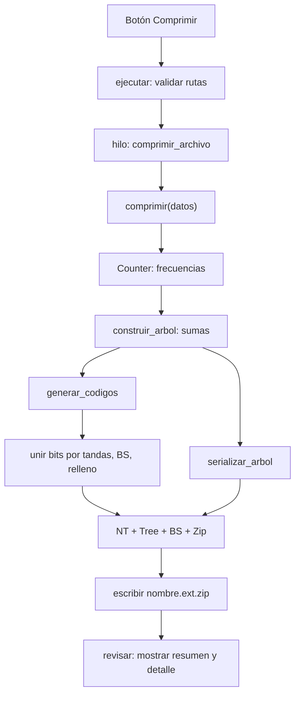
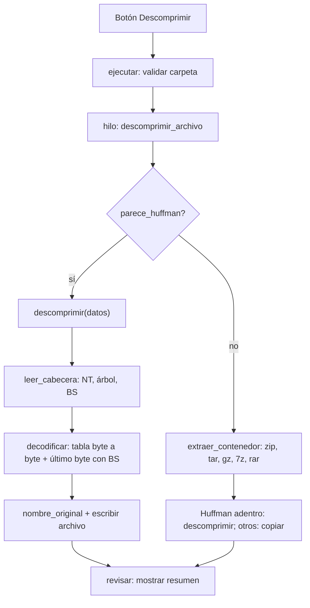

# 04 · Guía del código (`src/huffman_gui.py`)

[← Volver al índice](../README.md) · Anterior: [03 Compresión y descompresión](03-compresion-y-descompresion.md) · Siguiente: [05 Ejercicios y resumen](05-ejercicios-y-resumen.md)

Explicación **función por función** del programa. Los fragmentos de código son copias exactas del archivo (con sus números de línea reales) y cada uno se relaciona con el paso del tablero que implementa.

## Contenido

1. [Mapa del archivo](#1-mapa-del-archivo)
2. [Cómo leer el código: bytes y enteros](#2-cómo-leer-el-código-bytes-y-enteros)
3. [Bloque 1: el algoritmo de Huffman](#3-bloque-1-el-algoritmo-de-huffman-líneas-42-227)
4. [Bloque 2: el detalle del cálculo](#4-bloque-2-el-detalle-del-cálculo-líneas-230-304)
5. [Bloque 3: nombre y extensión del archivo](#5-bloque-3-nombre-y-extensión-del-archivo-líneas-307-347)
6. [Bloque 4: trabajar con archivos](#6-bloque-4-trabajar-con-archivos-líneas-335-552)
7. [Bloque 5: la interfaz gráfica](#7-bloque-5-la-interfaz-gráfica-líneas-555-786)
8. [Flujo completo de punta a punta](#8-flujo-completo-de-punta-a-punta)
9. [Casos límite y cómo los maneja](#9-casos-límite-y-cómo-los-maneja)
10. [Cómo ejecutarlo y probarlo](#10-cómo-ejecutarlo-y-probarlo)
11. [Ejercicio de estudio: invertir la convención](#11-ejercicio-de-estudio-invertir-la-convención-1--izquierda)

---

## 1. Mapa del archivo

| Bloque | Líneas | Funciones y clases | Qué hace |
| --- | --- | --- | --- |
| Cabecera y `import` | 1 a 39 | — | Documenta el formato `NT \| Tree \| BS \| Zip` e importa las librerías. |
| **1. Algoritmo** | 42 a 227 | `Nodo`, `construir_arbol`, `generar_codigos`, `serializar_arbol`, `leer_arbol`, `contar_internos`, `leer_cabecera`, `comprimir`, `tabla_de_decodificacion`, `decodificar`, `descomprimir` | Todo el Huffman: árbol, códigos, archivo comprimido y su lectura. |
| **2. Detalle del cálculo** | 230 a 304 | `legible`, `texto_tree`, `texto_codigos`, `texto_compresion`, `texto_descompresion` | Genera el texto que se muestra en pantalla (tablas, ZIP, NT, BS, factor). |
| **3. Nombre y extensión** | 307 a 347 | `detectar_extension`, `nombre_original` | Adivina la extensión del archivo recuperado. |
| **4. Archivos** | 335 a 552 | `comprimir_archivo`, `parece_huffman`, `ruta_segura`, `quitar_extension`, `buscar_programa`, `programas_externos`, `extraer_con_programa`, `extraer_contenedor`, `descomprimir_archivo` | Lee y escribe archivos; además abre comprimidos normales (`.zip`, `.tar`, `.gz`, `.7z`, `.rar`, …). |
| **5. Interfaz** | 555 a 786 | `tamano`, clase `Aplicacion` | La ventana con Tkinter. |
| Punto de entrada | 789 y 790 | — | Abre la ventana. |

El **corazón** son las líneas 42 a 227. Todo lo demás es presentación y manejo de archivos.

## 2. Cómo leer el código: bytes y enteros

En Python 3, cuando se recorre un objeto `bytes` cada elemento es un **entero de 0 a 255**. Por eso en todo el programa un "símbolo" es un número (el ASCII del byte), no una letra:

```python
>>> list(b"ana")
[97, 110, 97]
```

Consecuencias:

- El **desempate por ASCII** es simplemente ordenar por ese entero.
- Un archivo con `ñ` en UTF-8 tiene **dos símbolos** por esa letra (195 y 177).
- El programa sirve igual para texto, imágenes o cualquier archivo.

## 3. Bloque 1: el algoritmo de Huffman (líneas 42 a 227)

### 3.1 `class Nodo` (líneas 45 a 53)

```python
  45  class Nodo:
  46      def __init__(self, frecuencia, simbolo=None, izq=None, der=None):
  47          self.frecuencia = frecuencia
  48          self.simbolo = simbolo      # byte (0..255) si es hoja, None si es interno
  49          self.izq = izq
  50          self.der = der
  51  
  52      def es_hoja(self):
  53          return self.simbolo is not None
```

*Líneas 45 a 53 de `src/huffman_gui.py`.*

Un `Nodo` representa **hoja** o **nodo interno** según tenga o no símbolo:

| Atributo | Hoja | Nodo interno |
| --- | --- | --- |
| `frecuencia` | TF del carácter | suma de las frecuencias de sus hijos |
| `simbolo` | el byte (0 a 255) | `None` |
| `izq`, `der` | `None` | los dos hijos |

`es_hoja()` devuelve `True` si hay símbolo. Ojo: usa `is not None` y no `if self.simbolo`, porque el byte `0` es un símbolo válido y `0` también es "falso" en Python.

### 3.2 `construir_arbol` (líneas 56 a 67): las sumas de la guía 02

```python
  56  def construir_arbol(frecuencias):
  57      """Une siempre los dos nodos de menor frecuencia hasta que queda uno."""
  58      lista = [Nodo(f, s) for s, f in sorted(frecuencias.items(), key=lambda x: (x[1], x[0]))]
  59      while len(lista) > 1:
  60          a = lista.pop(0)            # el menor   -> rama 0 (izquierda)
  61          b = lista.pop(0)            # el segundo -> rama 1 (derecha)
  62          nuevo = Nodo(a.frecuencia + b.frecuencia, izq=a, der=b)
  63          pos = 0
  64          while pos < len(lista) and lista[pos].frecuencia <= nuevo.frecuencia:
  65              pos += 1
  66          lista.insert(pos, nuevo)
  67      return lista[0]
```

*Líneas 56 a 67 de `src/huffman_gui.py`.*

Es la implementación exacta de las reglas 1 a 5 del profesor:

| Línea | Qué hace | Regla |
| --- | --- | --- |
| 58 | Crea la lista inicial de hojas **ordenada por `(frecuencia, símbolo)`**: menor frecuencia primero y, si empatan, menor ASCII. | 1 |
| 59 | Repite mientras queden **dos o más** nodos. | — |
| 60 y 61 | `pop(0)` saca los **dos primeros**: `a` (el menor) y `b` (el segundo). | 2 |
| 62 | Crea el nodo nuevo con `a` a la **izquierda**, `b` a la **derecha** y frecuencia = **suma**. | 3 y 4 |
| 63 a 65 | Busca la posición: avanza `pos` mientras el nodo de esa posición pese **menor o igual** (`<=`) que el nuevo. | 5 |
| 66 | Inserta el nodo nuevo en `pos`, o sea **después de todos los iguales**. | 5 |
| 67 | Al final queda un solo nodo: la raíz. | — |

La línea 64 es **la regla del dedo** de la guía 02: `pos` es el dedo y avanza mientras `frecuencia <= nuevo.frecuencia`. Si fuera `<` en vez de `<=`, el nodo se pondría **antes** de los iguales y el árbol cambiaría (es el error de la sección 7 de la guía 02).

**Traza con "anita patina".** Los símbolos son bytes: espacio = 32, p = 112, i = 105, n = 110, t = 116, a = 97.

| Momento | `lista` (frecuencia:símbolo) |
| --- | --- |
| Después de la línea 58 | `1:32, 1:112, 2:105, 2:110, 2:116, 4:97` |
| Paso 1: `a`=`1:32`, `b`=`1:112`, nuevo = 2. `lista` queda `2:105, 2:110, 2:116, 4:97`; `pos` avanza sobre 105, 110, 116 (todos ≤ 2) y se detiene en `4:97` | `2:105, 2:110, 2:116, 2:(32,112), 4:97` |
| Paso 2: `a`=`2:105`, `b`=`2:110`, nuevo = 4. `pos` pasa los tres de peso 2 y también `4:97` (4 ≤ 4) | `2:116, 2:(32,112), 4:97, 4:(105,110)` |
| Paso 3: `a`=`2:116`, `b`=`2:(32,112)`, nuevo = 4. `pos` pasa `4:97` y `4:(105,110)` | `4:97, 4:(105,110), 4:(116,(32,112))` |
| Paso 4: `a`=`4:97`, `b`=`4:(105,110)`, nuevo = 8 | `4:(116,(32,112)), 8:(97,(105,110))` |
| Paso 5: se unen los dos y queda **12**, la raíz | `12` |

Es la misma tabla de la [guía 02](02-suma-de-arboles.md#3-ejemplo-completo-anita-patina), con los símbolos en número.

### 3.3 `generar_codigos` (líneas 70 a 78)

```python
  70  def generar_codigos(nodo, prefijo="", codigos=None):
  71      if codigos is None:
  72          codigos = {}
  73      if nodo.es_hoja():
  74          codigos[nodo.simbolo] = prefijo or "0"     # un solo símbolo -> código "0"
  75      else:
  76          generar_codigos(nodo.izq, prefijo + "0", codigos)
  77          generar_codigos(nodo.der, prefijo + "1", codigos)
  78      return codigos
```

*Líneas 70 a 78 de `src/huffman_gui.py`.*

Recorre el árbol y construye el código de cada hoja:

- **Bajar a la izquierda** añade un `"0"` y **bajar a la derecha** añade un `"1"` (regla 6).
- Al llegar a una hoja guarda `codigos[símbolo] = prefijo`.
- **`prefijo or "0"`** es para el caso especial de un archivo con **un solo símbolo distinto**: el árbol es una sola hoja, el prefijo es `""` (vacío) y se le asigna el código `"0"`.
- El parámetro `codigos=None` crea un diccionario nuevo en la primera llamada (en Python no se debe poner `{}` como valor por defecto).

La función es **recursiva**: la profundidad máxima es la del árbol, como mucho 255, muy por debajo del límite de recursión de Python (1000).

### 3.4 `serializar_arbol` (líneas 81 a 88)

```python
  81  def serializar_arbol(nodo, salida):
  82      """Tree en preorden: nodo interno = 0 0, hoja = 1 ASCII."""
  83      if nodo.es_hoja():
  84          salida += [1, nodo.simbolo]
  85      else:
  86          salida += [0, 0]
  87          serializar_arbol(nodo.izq, salida)
  88          serializar_arbol(nodo.der, salida)
```

*Líneas 81 a 88 de `src/huffman_gui.py`.*

Implementa la regla 11: el **preorden** (nodo, luego izquierda, luego derecha):

- Hoja: añade dos números `1, símbolo`.
- Nodo interno: añade `0, 0` y después serializa el hijo izquierdo y el derecho.

Con "anita patina" produce `0 0 0 0 1 116 0 0 1 32 1 112 0 0 1 97 0 0 1 105 1 110` (22 números). `salida` es una lista que se va llenando; por eso la función no necesita devolver nada.

### 3.5 `leer_arbol` (líneas 91 a 102)

```python
  91  def leer_arbol(datos, pos, doble=True):
  92      """Reconstruye el árbol desde el Tree. Devuelve (nodo, siguiente_posición).
  93      doble=True  -> nodo interno = 0 0 (formato del cuaderno)
  94      doble=False -> nodo interno = 0   (variante de un solo byte)"""
  95      marca = datos[pos]
  96      if marca == 1:                                  # hoja: el siguiente byte es el ASCII
  97          return Nodo(0, simbolo=datos[pos + 1]), pos + 2
  98      if marca != 0 or (doble and datos[pos + 1] != 0):
  99          raise ValueError("marca de árbol inválida")
 100      izq, pos = leer_arbol(datos, pos + (2 if doble else 1), doble)   # primero la izquierda
 101      der, pos = leer_arbol(datos, pos, doble)                         # luego la derecha
 102      return Nodo(0, izq=izq, der=der), pos
```

*Líneas 91 a 102 de `src/huffman_gui.py`.*

Es el camino inverso: reconstruye el árbol a partir de la lista de bytes, empezando en la posición `pos`. **Devuelve el nodo y la posición siguiente**, para que la llamada anterior sepa dónde continuar.

- **Líneas 96 y 97:** si la marca es `1`, es una **hoja** y el siguiente byte es el símbolo. Avanza 2 posiciones.
- **Línea 98:** valida. Para un nodo interno la marca debe ser `0` y, en el formato del cuaderno (`doble=True`), el byte siguiente también debe ser `0`.
- **Líneas 100 y 101:** lee **primero el hijo izquierdo y luego el derecho**, igual que el orden en que se escribieron. Un nodo interno salta 2 bytes (`0 0`) o 1 (`0` solo, con `doble=False`).
- El parámetro `doble` permite leer la **variante** en la que el nodo interno es un solo `0`, por compatibilidad con archivos de otros compañeros.

### 3.6 `contar_internos` (líneas 105 a 108)

```python
 105  def contar_internos(nodo):
 106      if nodo.es_hoja():
 107          return 0
 108      return 1 + contar_internos(nodo.izq) + contar_internos(nodo.der)
```

*Líneas 105 a 108 de `src/huffman_gui.py`.*

Cuenta los nodos internos del árbol (hojas valen 0). Se usa para calcular **NT** al comprimir y para **validar** el archivo al descomprimir.

### 3.7 `leer_cabecera` (líneas 111 a 122)

```python
 111  def leer_cabecera(datos, tamano_total=None, doble=True):
 112      """Lee NT | Tree | BS. Devuelve (nt, raiz, bs, inicio_del_zip) o lanza ValueError."""
 113      tamano_total = len(datos) if tamano_total is None else tamano_total
 114      try:
 115          nt = datos[0]
 116          raiz, pos = leer_arbol(datos, 1, doble)
 117          bs = datos[pos]
 118      except (IndexError, RecursionError):
 119          raise ValueError("cabecera incompleta")
 120      if contar_internos(raiz) != nt or not 1 <= bs <= 8 or tamano_total <= pos + 1:
 121          raise ValueError("cabecera inválida")
 122      return nt, raiz, bs, pos + 1
```

*Líneas 111 a 122 de `src/huffman_gui.py`.*

Lee `NT | Tree | BS` y comprueba que tengan sentido:

| Validación | Qué detecta |
| --- | --- |
| `IndexError` o `RecursionError` | El archivo termina antes de completar el árbol (cabecera incompleta). |
| `contar_internos(raiz) != nt` | El número de nodos internos leído del árbol no coincide con NT. |
| `not 1 <= bs <= 8` | BS fuera de rango. |
| `tamano_total <= pos + 1` | No queda ningún byte para el ZIP. |

Devuelve `(nt, raiz, bs, inicio_del_zip)`. **Es lo que permite reconocer si un archivo es Huffman** sin importar su extensión (ver `parece_huffman`).

Ejemplo con el archivo de "banana" (14 bytes):

| Posición | 0 | 1 a 10 | 11 | 12 y 13 |
| --- | --- | --- | --- | --- |
| Valor | `2` | `0 0 1 97 0 0 1 98 1 110` | `1` | `155 0` |
| Campo | NT | Tree (4·2 + 2 = 10 bytes) | BS | ZIP |

### 3.8 `comprimir` (líneas 125 a 155)

```python
 125  def comprimir(datos):
 126      """Devuelve (bytes_comprimidos, texto_con_el_detalle_del_cálculo)."""
 127      if not datos:
 128          raise ValueError("El archivo está vacío: no hay nada que comprimir.")
 129  
 130      frecuencias = Counter(datos)
 131      raiz = construir_arbol(frecuencias)
 132      codigos = generar_codigos(raiz)
 133  
 134      # Unir los códigos y agrupar de 8 en 8 bits. Se hace por bloques para que
 135      # funcione rápido y sin gastar mucha memoria con archivos grandes.
 136      tabla = [codigos.get(i, "") for i in range(256)]
 137      partes, resto, BLOQUE = [], "", 1 << 16
 138      for i in range(0, len(datos), BLOQUE):
 139          bits = resto + "".join(map(tabla.__getitem__, datos[i:i + BLOQUE]))
 140          completos = len(bits) // 8 * 8
 141          if completos:
 142              partes.append(int(bits[:completos], 2).to_bytes(completos // 8, "big"))
 143          resto = bits[completos:]
 144      bs = len(resto) or 8                            # bits válidos del último byte
 145      if resto:
 146          partes.append(bytes([int(resto.ljust(8, "0"), 2)]))   # relleno con ceros
 147      zip_bytes = b"".join(partes)
 148  
 149      tree = []
 150      serializar_arbol(raiz, tree)
 151      nt = contar_internos(raiz)
 152      resultado = bytes([nt]) + bytes(tree) + bytes([bs]) + zip_bytes
 153  
 154      detalle = texto_compresion(datos, frecuencias, codigos, zip_bytes, nt, raiz, bs, resultado)
 155      return resultado, detalle
```

*Líneas 125 a 155 de `src/huffman_gui.py`.*

Recibe los bytes del archivo y devuelve `(archivo_comprimido, texto_del_detalle)`.

| Líneas | Qué hace |
| --- | --- |
| 127 y 128 | Si el archivo está vacío, lanza un error. |
| 130 a 132 | Cuenta frecuencias (`Counter`), construye el árbol y genera los códigos (pasos 1 a 4 del tablero). |
| 136 | `tabla` es una lista de 256 posiciones: `tabla[b]` es el código del byte `b` (o `""` si no aparece). Así buscar el código de un byte es instantáneo. |
| 137 | `BLOQUE = 1 << 16` = 65.536 bytes por tanda; `resto` guarda los bits sobrantes entre tandas. |
| 138 a 143 | Procesa el archivo por tandas. Por cada tanda: une los códigos en una cadena de bits (con `resto` delante), toma los bits que forman **bytes completos** (`completos = múltiplo de 8`), los convierte en bytes con `int(..., 2).to_bytes(...)` y guarda el **resto** para la tanda siguiente. |
| 144 | `bs = len(resto) or 8`: los bits sobrantes finales son BS; si no sobra ninguno, el último byte está lleno y **BS = 8**. |
| 145 y 146 | Si sobraron bits, `ljust(8, "0")` los **rellena con ceros a la derecha** y los convierte en un byte. |
| 147 | `zip_bytes` es la sección ZIP completa. |
| 149 a 151 | Serializa el árbol y calcula NT. |
| 152 | Arma el archivo: `bytes([nt]) + bytes(tree) + bytes([bs]) + zip_bytes` (campos `NT | Tree | BS | Zip`). |
| 154 y 155 | Genera el texto del detalle y devuelve todo. |

**Por qué se procesa por tandas.** Si el archivo fuera de 100 MB, unir todos los códigos en una sola cadena de bits gastaría muchísima memoria. Con tandas de 64 KB se gasta poco y el resultado es el mismo. Los bits que no completan un byte se **arrastran** a la tanda siguiente (`resto`), así los bytes del ZIP no se desalinean.

**Traza con "anita patina"** (cabe en una sola tanda): los códigos unidos son `101111100010010011100011011110` (30 bits). `completos = 30 // 8 * 8 = 24` → 24 bits forman 3 bytes: `10111110`, `00100100`, `11100011` = 190, 36, 227. `resto = "011110"` (6 bits), así que `bs = 6` y `"011110".ljust(8, "0") = "01111000"` = 120. Archivo: `5` + 22 bytes de Tree + `6` + `190 36 227 120` = **28 bytes**.

### 3.9 `tabla_de_decodificacion` (líneas 158 a 182)

```python
 158  def tabla_de_decodificacion(raiz):
 159      """Para cada nodo interno y cada byte posible (0..255) calcula, recorriendo
 160      los 8 bits en el árbol, a qué nodo se llega y qué letras salen. Así se
 161      descomprime byte por byte en vez de bit por bit (mucho más rápido)."""
 162      internos = []
 163  
 164      def numerar(n):
 165          if not n.es_hoja():
 166              n.id = len(internos)
 167              internos.append(n)
 168              numerar(n.izq)
 169              numerar(n.der)
 170      numerar(raiz)
 171  
 172      tabla = []
 173      for inicio in internos:
 174          for byte in range(256):
 175              nodo, salida = inicio, bytearray()
 176              for k in range(7, -1, -1):
 177                  nodo = nodo.der if (byte >> k) & 1 else nodo.izq
 178                  if nodo.es_hoja():
 179                      salida.append(nodo.simbolo)
 180                      nodo = raiz
 181              tabla.append((nodo.id * 256, bytes(salida)))
 182      return tabla, internos
```

*Líneas 158 a 182 de `src/huffman_gui.py`.*

Es una **optimización** para descomprimir rápido. En lugar de leer los bits de uno en uno (lento en Python), se precalcula qué pasa al leer **un byte entero** estando en cada nodo interno.

1. **`numerar`** (164 a 170) recorre el árbol en preorden y le pone un `id` a cada nodo interno (la raíz es 0). Los guarda en `internos`.
2. **Doble bucle** (173 a 181): para **cada nodo interno** (`inicio`) y **cada valor de byte posible** (0 a 255) simula los 8 bits, de izquierda a derecha (`k` de 7 a 0, `(byte >> k) & 1` extrae el bit):
   - Baja a la derecha si el bit es 1 y a la izquierda si es 0 (`nodo.der if ... else nodo.izq`).
   - Si llega a una **hoja**, anota el símbolo en `salida` y **vuelve a la raíz**.
3. **`tabla.append((nodo.id * 256, bytes(salida)))`**: guarda dos cosas: el **estado final** (en qué nodo interno terminó, multiplicado por 256) y las **letras** que salieron.

El estado se guarda ya multiplicado por 256 para que `tabla[estado + byte]` sea directamente el índice: la fila de cada nodo interno `id` empieza en `id * 256`.

**Ejemplo con "banana"** (árbol: raíz = `(a, (b, n))`; `internos` = [raíz (id 0), nodo `(b,n)` (id 1)]). Para la raíz y el byte 155 (`10011011`):

| Bit | Movimiento | Resultado |
| --- | --- | --- |
| 1 | raíz → derecha | nodo `(b,n)` |
| 0 | izquierda | hoja **b** → salida `b`, vuelve a la raíz |
| 0 | izquierda | hoja **a** → salida `ba`, raíz |
| 1 | derecha | nodo `(b,n)` |
| 1 | derecha | hoja **n** → salida `ban`, raíz |
| 0 | izquierda | hoja **a** → salida `bana`, raíz |
| 1 | derecha | nodo `(b,n)` |
| 1 | derecha | hoja **n** → salida `banan`, raíz |

Entrada de la tabla: `tabla[0 + 155] = (0, b"banan")`: termina en la raíz y produjo `banan`.

### 3.10 `decodificar` (líneas 185 a 202)

```python
 185  def decodificar(raiz, zip_bytes, bs):
 186      """Recorre el árbol con los bits del Zip. Devuelve (datos, terminó_bien)."""
 187      total_bits = (len(zip_bytes) - 1) * 8 + bs
 188      if raiz.es_hoja():                              # un solo símbolo en todo el archivo
 189          return bytes([raiz.simbolo]) * total_bits, True
 190  
 191      tabla, internos = tabla_de_decodificacion(raiz)
 192      partes, estado = [], 0                          # estado 0 = raíz
 193      for byte in zip_bytes[:-1]:                     # bytes completos
 194          estado, letras = tabla[estado + byte]
 195          partes.append(letras)
 196      nodo, ultimo = internos[estado // 256], zip_bytes[-1]
 197      for k in range(7, 7 - bs, -1):                  # último byte: solo los BS bits válidos
 198          nodo = nodo.der if (ultimo >> k) & 1 else nodo.izq
 199          if nodo.es_hoja():
 200              partes.append(bytes([nodo.simbolo]))
 201              nodo = raiz
 202      return b"".join(partes), nodo is raiz
```

*Líneas 185 a 202 de `src/huffman_gui.py`.*

| Líneas | Qué hace |
| --- | --- |
| 187 | Calcula los bits válidos: `(bytes del ZIP − 1) × 8 + BS` (la fórmula de la guía 03). |
| 188 y 189 | **Caso especial:** si la raíz es una hoja (un solo símbolo), cada bit equivale a una repetición del símbolo. |
| 191 | Construye la tabla de la sección anterior. |
| 192 a 195 | Recorre todos los bytes **menos el último**: busca `tabla[estado + byte]`, guarda las letras y actualiza el estado. |
| 196 | Recupera el nodo donde quedó el recorrido y toma el último byte. |
| 197 a 201 | El **último byte** se lee bit a bit, pero **solo los BS primeros**: `range(7, 7 - bs, -1)`. Así se **ignora el relleno**. |
| 202 | Devuelve los datos y si terminó bien (`nodo is raiz`: el último bit cerró una hoja). |

**Por qué el último byte va aparte.** Los bytes completos usan la tabla (rápido). El último tiene relleno y solo valen los BS primeros bits, así que se procesa a mano.

Para "banana": bytes completos = `[155]` → `banan`, estado raíz; último byte = `0` con `bs = 1`: lee 1 bit (`0`) → hoja `a`. Resultado `banana`.

### 3.11 `descomprimir` (líneas 205 a 227)

```python
 205  def descomprimir(datos):
 206      """Devuelve (bytes_originales, texto_con_el_detalle_del_cálculo)."""
 207      intentos = []
 208      for doble in (True, False):                     # primero 0 0 (cuaderno), luego 0
 209          try:
 210              intentos.append((doble,) + leer_cabecera(datos, doble=doble))
 211          except ValueError:
 212              pass
 213      if not intentos:
 214          raise ValueError("El archivo no tiene el formato Huffman NT | Tree | BS | Zip.")
 215  
 216      primero = None
 217      for doble, nt, raiz, bs, inicio in intentos:
 218          salida, bien = decodificar(raiz, datos[inicio:], bs)
 219          if primero is None:
 220              primero = (doble, nt, raiz, bs, inicio, salida, bien)
 221          if bien:
 222              break
 223      else:
 224          doble, nt, raiz, bs, inicio, salida, bien = primero
 225  
 226      detalle = texto_descompresion(nt, raiz, bs, datos[inicio:], salida, doble, bien)
 227      return salida, detalle
```

*Líneas 205 a 227 de `src/huffman_gui.py`.*

Orquesta la descompresión:

1. **Líneas 208 a 212:** intenta leer la cabecera con el formato del cuaderno (`doble=True`, nodo interno `0 0`) y, si no sirve, con la variante (`doble=False`, nodo interno `0`). Guarda cada intento válido en `intentos`.
2. **213 y 214:** si ningún formato sirve, error: "no tiene el formato Huffman".
3. **216 a 224:** prueba cada intento con `decodificar`. Se queda con el primero que termine **bien** (`bien`). Si ninguno termina bien, usa el primero (`for ... else` ejecuta el `else` cuando el bucle no se cortó con `break`).
4. **226 y 227:** genera el detalle y devuelve los bytes originales.

## 4. Bloque 2: el detalle del cálculo (líneas 230 a 304)

Estas funciones **no cambian el resultado**: solo arman el texto que se ve en la ventana.

| Función | Líneas | Qué produce |
| --- | --- | --- |
| `legible(b)` | 233 a 237 | Convierte un byte en algo que se pueda mostrar: `32` → `esp`, `10` → `\n`, letras visibles tal cual y el resto como `#número`. |
| `texto_tree(raiz, maximo=24)` | 240 a 254 | El Tree escrito en preorden (`00 00 1 116 …`), con máximo 24 elementos y `...` si hay más. |
| `texto_codigos(codigos)` | 257 a 261 | La tabla de códigos ordenada por largo de código. |
| `texto_compresion(...)` | 264 a 287 | El informe de la compresión (ver abajo). |
| `texto_descompresion(...)` | 290 a 304 | El informe de la descompresión: NT, Tree, BS, bits válidos, códigos del árbol y el mensaje recuperado. |

`texto_compresion` imprime, en este orden:

1. Tamaño original en bytes y bits.
2. **TABLA DE FRECUENCIAS** (letra, TF, ASCII, código, bits) ordenada por frecuencia descendente, y el total de bits.
3. La **SECUENCIA** de códigos (solo si el texto tiene 40 bytes o menos).
4. El **ZIP** (los primeros 10 bytes, en binario y decimal).
5. **NT**, **Tree** (`4·NT + 2` bytes), **BS** y el tamaño del archivo (`1 + Tree + 1 + ZIP`).
6. Los **dos factores**: ZIP/original (el del examen) y archivo completo/original.

Es, línea por línea, el esquema del tablero. Con "anita patina" imprime exactamente: `Total = 30 bits`, ZIP `190, 36, 227, 120`, `NT = 5`, `BS = 6`, `Zip: 4/12 bytes = 33.3 %`.

## 5. Bloque 3: nombre y extensión del archivo (líneas 307 a 347)

### `detectar_extension` (líneas 310 a 332)

Cuando el archivo comprimido no recuerda su extensión original, la adivina por los **primeros bytes** del contenido (las "firmas" de cada formato):

| Primeros bytes | Extensión |
| --- | --- |
| `PK\x03\x04` | `zip` (o `docx`, `xlsx`, `pptx` si adentro hay `word/`, `xl/` o `ppt/`) |
| `%PDF` | `pdf` |
| `\x89PNG` | `png` |
| `\xff\xd8\xff` | `jpg` |
| `GIF8` | `gif` |
| `Rar!`, `7z\xbc\xaf`, `\x1f\x8b` | `rar`, `7z`, `gz` |
| `RIFF…WAVE`, `RIFF…AVI `, `RIFF…WEBP` | `wav`, `avi`, `webp` |
| `ftyp` en la posición 4 | `mp4` |
| se puede leer como UTF-8 | `txt` |
| cualquier otro caso | `bin` |

### `nombre_original` (líneas 341 a 347)

```python
 341  def nombre_original(nombre, datos):
 342      """doc.doc.zip -> doc.doc ;  mensaje.zip -> mensaje.txt (extensión por su contenido)"""
 343      if nombre.lower().endswith(EXT_HUFFMAN):
 344          nombre = nombre[:-4]
 345      if "." not in nombre:
 346          nombre += "." + detectar_extension(datos)
 347      return nombre or "archivo"
```

*Líneas 341 a 347 de `src/huffman_gui.py`.*

- `doc.doc.zip` → `doc.doc` (se quita el `.zip`).
- `mensaje.zip` → `mensaje` no tiene punto, así que se le agrega la extensión detectada: `mensaje.txt`.
- Por eso un archivo **sin extensión** (por ejemplo `LEEME`) vuelve como `LEEME.txt`. El contenido es idéntico y solo cambia el nombre.

## 6. Bloque 4: trabajar con archivos (líneas 335 a 552)

### `comprimir_archivo` (350 a 357)

```python
 350  def comprimir_archivo(ruta, ruta_zip):
 351      """Comprime un archivo con Huffman y lo guarda como .zip. Devuelve (detalle, original, final)."""
 352      with open(ruta, "rb") as f:
 353          datos = f.read()
 354      comprimido, detalle = comprimir(datos)
 355      with open(ruta_zip, "wb") as f:
 356          f.write(comprimido)
 357      return detalle, len(datos), len(comprimido)
```

*Líneas 350 a 357 de `src/huffman_gui.py`.*

Lee todo el archivo en memoria, llama a `comprimir` y escribe el resultado como `nombre.ext.zip`. Devuelve el detalle y los tamaños.

### `parece_huffman` (360 a 374)

```python
 360  def parece_huffman(ruta):
 361      """¿El archivo tiene la forma NT | Tree | BS | Zip? (sin importar la extensión)"""
 362      try:
 363          tamano = os.path.getsize(ruta)
 364          with open(ruta, "rb") as f:
 365              cabecera = f.read(2048)                 # el Tree ocupa como máximo 1022 bytes
 366      except OSError:
 367          return False
 368      for doble in (True, False):
 369          try:
 370              leer_cabecera(cabecera, tamano, doble)
 371              return True
 372          except ValueError:
 373              pass
 374      return False
```

*Líneas 360 a 374 de `src/huffman_gui.py`.*

Decide si un archivo **es Huffman** (formato `NT | Tree | BS | Zip`), sin mirar la extensión:

- Lee solo los **primeros 2048 bytes**: la cabecera máxima mide `1 + 1022 + 1 = 1024` bytes (con 255 nodos internos el Tree ocupa 4·255 + 2 = 1022).
- Intenta `leer_cabecera` con los dos formatos. Pasa el **tamaño real** del archivo para poder verificar que quede al menos un byte de ZIP.
- En las pruebas, 20.000 archivos aleatorios dieron **0 falsos positivos**: un texto, un PDF o una imagen casi nunca cumplen a la vez "el Tree es válido", "NT coincide" y "BS entre 1 y 8".

### Constantes y utilidades (377 a 427)

| Elemento | Líneas | Para qué sirve |
| --- | --- | --- |
| `EXTENSIONES` | 377 y 378 | Filtro del diálogo "Buscar…" (`*.zip *.rar *.7z …`). |
| `FIRMA_GZ`, `FIRMA_BZ2`, `FIRMA_XZ`, `FIRMA_7Z`, `FIRMA_RAR` | 380 y 381 | Los primeros bytes de esos formatos. |
| `ruta_segura(base, nombre)` | 384 a 388 | **Seguridad.** Al extraer un comprimido normal quita `..`, `.` y `:` de las rutas, para que un archivo malicioso no escriba **fuera** de la carpeta de destino. |
| `quitar_extension(nombre)` | 391 a 395 | Quita `.tar.gz`, `.tar.bz2`, `.tar.xz` completos o la última extensión. |
| `buscar_programa(...)` | 398 a 408 | Busca un ejecutable en el `PATH` y en las carpetas típicas de Windows. |
| `programas_externos(es_rar)` | 411 a 427 | Lista los programas instalados que pueden extraer: 7-Zip, UnRAR, The Unarchiver, `bsdtar`/`tar`. |

### `extraer_con_programa` (430 a 450)

Prueba cada programa externo disponible. Si uno funciona (`returncode == 0` y la carpeta quedó con archivos), devuelve el nombre. Si ninguno funciona, lanza un error claro: "se necesita un programa extra" (con la dirección de 7-Zip) o "puede estar dañado".

### `extraer_contenedor` (453 a 503)

Abre un **comprimido normal** en una carpeta temporal. Detecta el tipo en este orden:

| Orden | Formato | Cómo lo abre |
| --- | --- | --- |
| 1 | ZIP estándar (`zipfile.is_zipfile`) | `zipfile`, con `ruta_segura` |
| 2 | TAR (`tarfile.is_tarfile`) | `tarfile`, con `ruta_segura` |
| 3 | GZ, BZ2, XZ (por firma) | `gzip`, `bz2`, `lzma` |
| 4 | 7Z | `py7zr` si está instalado; si no, 7-Zip |
| 5 | RAR | UnRAR / 7-Zip |
| 6 | Otro | Cualquier programa externo disponible |

### `descomprimir_archivo` (506 a 552)

```python
 506  def descomprimir_archivo(ruta, carpeta):
 507      """Descomprime un archivo. Devuelve (detalle, lista_de_archivos_creados)."""
 508      os.makedirs(carpeta, exist_ok=True)
 509  
 510      # 1. Archivo Huffman directo (NT | Tree | BS | Zip), con cualquier extensión
 511      if parece_huffman(ruta):
 512          with open(ruta, "rb") as f:
 513              datos, detalle = descomprimir(f.read())
 514          destino = os.path.join(carpeta, nombre_original(os.path.basename(ruta), datos))
 515          with open(destino, "wb") as f:
 516              f.write(datos)
 517          return ("Formato detectado: Huffman (NT | Tree | BS | Zip)\n"
 518                  f"{os.path.basename(ruta)}  →  {os.path.basename(destino)}\n\n{detalle}"), [destino]
 519  
 520      # 2. Comprimido normal: se extrae y, si adentro hay archivos Huffman, se descomprimen
 521      partes, creados, copiados = [], [], []
 522      with tempfile.TemporaryDirectory() as temporal:
 523          formato = extraer_contenedor(ruta, temporal)
 524          for raiz, _, archivos in os.walk(temporal):
 525              for a in sorted(archivos):
 526                  origen = os.path.join(raiz, a)
 527                  relativo = os.path.relpath(origen, temporal)
 528                  if a.lower().endswith(EXT_HUFFMAN) and parece_huffman(origen):
 529                      with open(origen, "rb") as f:
 530                          datos, detalle = descomprimir(f.read())
 531                      destino = os.path.join(carpeta, os.path.dirname(relativo), nombre_original(a, datos))
 532                      os.makedirs(os.path.dirname(destino), exist_ok=True)
 533                      with open(destino, "wb") as f:
 534                          f.write(datos)
 535                      creados.append(destino)
 536                      partes.append(f"══════ {relativo}  →  {os.path.basename(destino)}  (Huffman) ══════\n{detalle}")
 537                  else:
 538                      destino = os.path.join(carpeta, relativo)
 539                      os.makedirs(os.path.dirname(destino), exist_ok=True)
 540                      shutil.copy2(origen, destino)
 541                      creados.append(destino)
 542                      copiados.append(relativo)
 543  
 544      texto = (f"Formato detectado: {formato}\n"
 545               f"Archivos Huffman: {len(creados) - len(copiados)}   ·   Otros archivos: {len(copiados)}\n\n")
 546      if copiados:
 547          partes.append("══════ Archivos extraídos tal cual ══════\n" +
 548                        "\n".join("   " + c for c in copiados[:200]) +
 549                        (f"\n   ... y {len(copiados) - 200} más" if len(copiados) > 200 else "") + "\n")
 550      if not creados:
 551          partes.append("El archivo comprimido estaba vacío.\n")
 552      return texto + "\n".join(partes), creados
```

*Líneas 506 a 552 de `src/huffman_gui.py`.*

Es la función que une todo. Tiene **dos caminos**:

1. **Archivo Huffman directo** (líneas 510 a 518): si `parece_huffman`, lo descomprime con `descomprimir`, calcula el nombre con `nombre_original` y escribe el resultado.
2. **Comprimido normal** (líneas 520 a 552): lo extrae a una carpeta temporal y recorre todo lo que salió. Si **dentro** hay archivos `.zip`/`.pkz`/`.huf` que parecen Huffman, los descomprime; los demás los copia tal cual. Al final escribe un resumen.

## 7. Bloque 5: la interfaz gráfica (líneas 555 a 786)

### `tamano` (558 y 559)

Formatea números con puntos de miles: `1234567` → `1.234.567 bytes`.

### `class Aplicacion(tk.Tk)` (562 a 786)

| Método | Líneas | Qué hace |
| --- | --- | --- |
| `__init__` | 563 a 625 | Crea la ventana con una **rejilla** (`grid`): título, selector de modo, entradas de archivo y de destino, botón de acción, resumen y cuadro de texto con barras de desplazamiento. |
| `comprimiendo` | 628 y 629 | `True` si el modo elegido es "comprimir". |
| `salida_es_carpeta` | 631 y 632 | El destino es **carpeta** al descomprimir o al comprimir varios archivos; es **archivo** al comprimir uno. |
| `actualizar_etiquetas` | 634 a 642 | Cambia los textos de las etiquetas y del botón según el modo. |
| `cambiar_modo` | 644 a 650 | Al cambiar de modo, borra la selección y el resultado. |
| `buscar_entrada` | 652 a 674 | Abre el diálogo para elegir archivos y propone un destino: `archivo.zip` al comprimir uno, la misma carpeta si son varios, `…_descomprimido` o `descomprimidos` al descomprimir. |
| `buscar_salida` | 676 a 686 | Abre el diálogo para cambiar el destino (carpeta o archivo). |
| `escribir` | 688 a 692 | Muestra texto en el cuadro (lo habilita, lo reemplaza y lo vuelve de solo lectura). |
| `ejecutar` | 694 a 786 | El botón principal (ver abajo). |

### `ejecutar` (694 a 786)

1. **Validaciones** (695 a 732): falta el archivo o el destino; el `.zip` de salida no puede reemplazar al archivo original; si ya existen archivos de salida, **pregunta** antes de reemplazarlos; al descomprimir, el destino debe ser una carpeta y, si ya tiene archivos, también pregunta.
2. **Hilo aparte** (735 a 769): el trabajo (`trabajo`) corre en un `threading.Thread` con `daemon=True` para que **la ventana no se congele** con archivos grandes. Mientras tanto se bloquea el botón y se muestra el cursor de espera.
3. **Resultado en un diccionario** (`resultado`): el hilo guarda ahí `"ok"` o `"error"`. No toca la interfaz, porque en Tkinter **solo el hilo principal** puede actualizar la ventana.
4. **Sondeo con `revisar`** (771 a 786): cada 150 ms (`self.after(150, revisar)`) pregunta si el hilo terminó. Cuando termina, reactiva el botón, muestra el resumen, el detalle del cálculo y un mensaje "Listo" (o el error).

## 8. Flujo completo de punta a punta

**Comprimir un archivo**



**Descomprimir un archivo**



## 9. Casos límite y cómo los maneja

Todos estos casos se probaron (ver [`tests/test_huffman.py`](../tests/test_huffman.py)):

| Caso | Qué hace el programa | Resultado de la prueba |
| --- | --- | --- |
| Archivo **vacío** | `ValueError`: "El archivo está vacío". | OK |
| **Un solo byte** (`a`) | Árbol de una hoja, NT = 0, código `0`. | Ida y vuelta idéntica |
| **Un solo símbolo** repetido (`z` × 1000) | `decodificar` repite el símbolo `total_bits` veces. | Idéntico |
| **256 valores** de byte distintos | NT = 255 (cabe en 1 byte), Tree de 1022 bytes. | Idéntico |
| Bits totales **múltiplo de 8** | BS = 8. | Idéntico |
| Árbol **muy profundo** (frecuencias tipo Fibonacci) | Códigos largos; la recursión no se desborda. | Idéntico |
| **Texto con ñ**, tildes y `\r\n` | Cada byte es un símbolo; sin problemas. | Idéntico |
| **Datos aleatorios** de 1 MB y 20 MB | Se expanden un poco (el árbol pesa más que el ahorro). | Idéntico |
| Nombre **sin extensión** | Vuelve con la extensión detectada (`LEEME` → `LEEME.txt`). | Contenido idéntico |

Resultado global: **0 fallos** en la ida y vuelta, y coincidencia total con una implementación independiente de las reglas del profesor en 3.000 casos aleatorios.

**Límites a tener en cuenta:**

- Todo el archivo se carga en memoria (`f.read()`).
- Solo usa la convención del tablero (0 izquierda, 1 derecha).
- No probado: la ventana en sí ni la extracción de `.rar` o `.7z` (necesitan 7-Zip instalado).

## 10. Cómo ejecutarlo y probarlo

**Requisitos:** Python 3.8 o superior con Tkinter (en Windows y macOS viene incluido; en Linux: `sudo apt install python3-tk`).

```bash
# Abrir la ventana
python src/huffman_gui.py

# Correr las pruebas (no necesitan la ventana)
python -m unittest discover -s tests -v
```

Para probar la lógica **sin interfaz**, desde Python:

```python
import sys
sys.path.insert(0, "src")
import huffman_gui as hg

archivo, detalle = hg.comprimir("anita patina".encode())
print(list(archivo))        # [5, 0,0,0,0,1,116, ..., 6, 190, 36, 227, 120]
print(detalle)              # tabla, ZIP, NT, BS y factor
original, _ = hg.descomprimir(archivo)
print(original.decode())    # anita patina
```

## 11. Ejercicio de estudio: invertir la convención (1 = izquierda)

El Test III pide 1 por la izquierda y 0 por la derecha. El programa **no** lo hace, pero se puede entender qué habría que cambiar. Son **solo los bits**, nunca la forma del árbol:

| Dónde | Línea | Cambio |
| --- | --- | --- |
| `generar_codigos` | 76 y 77 | Intercambiar `"0"` y `"1"`: la rama izquierda suma `"1"` y la derecha `"0"`. |
| `tabla_de_decodificacion` | 177 | `nodo.der if (byte >> k) & 1 else nodo.izq` pasa a `nodo.izq if (byte >> k) & 1 else nodo.der`. |
| `decodificar` | 198 | El mismo intercambio. |
| `serializar_arbol` y `leer_arbol` | 81 a 102 | **No cambian**: el preorden sigue siendo izquierda y luego derecha. |

Con ese cambio, "anita patina" da ZIP = 65, 219, 28, 132 y el **mismo Tree** (ver la [guía 03](03-compresion-y-descompresion.md#7-con-la-convención-invertida-1--izquierda)). Se probó sobre una copia del programa: la ida y vuelta fue idéntica en 2.000 casos aleatorios. La idea es la misma que en la guía 01: **el árbol es el mismo y cada código tiene sus bits invertidos**.

Ese cambio **no está incluido** en `src/huffman_gui.py`: el programa del cuaderno usa la convención del tablero.

---

[← Volver al índice](../README.md) · Anterior: [03 Compresión y descompresión](03-compresion-y-descompresion.md) · Siguiente: [05 Ejercicios y resumen](05-ejercicios-y-resumen.md)
