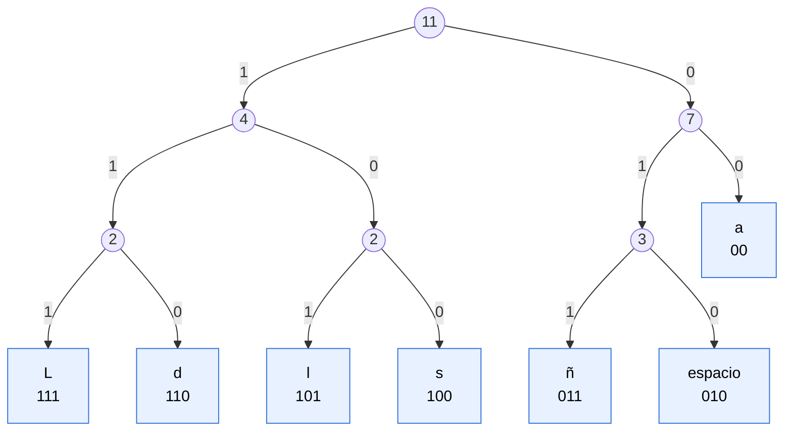
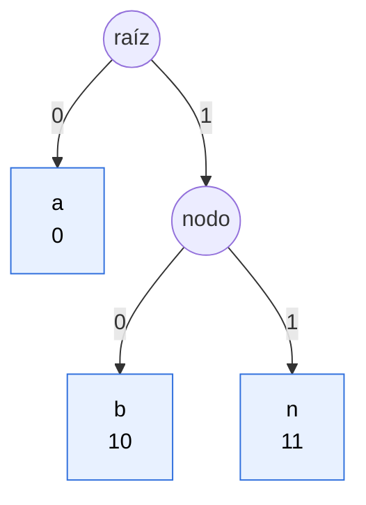

# 05 · Ejercicios resueltos, errores comunes y hoja de resumen

[← Volver al índice](../README.md) · Anterior: [04 Guía del código](04-guia-del-codigo.md)

## Contenido

1. [Ejercicio de examen: Test III (resuelto)](#1-ejercicio-de-examen-test-iii-resuelto)
2. [Ejercicios de compresión](#2-ejercicios-de-compresión)
3. [Ejercicios de descompresión](#3-ejercicios-de-descompresión)
4. [Ejercicios de bytes y de factor](#4-ejercicios-de-bytes-y-de-factor)
5. [Errores comunes](#5-errores-comunes)
6. [Preguntas de repaso](#6-preguntas-de-repaso)
7. [Hoja de resumen](#7-hoja-de-resumen-para-memorizar)

---

## 1. Ejercicio de examen: Test III (resuelto)

**Enunciado.** Calcular el factor de compresión de la oración de la tabla. **Se usa 1 por las ramas izquierdas y 0 por las ramas derechas.** El AS de cada carácter lo da el enunciado:

| L | a | a | a | a | (espacio) | (espacio) | s | l | d | ñ |
| --- | --- | --- | --- | --- | --- | --- | --- | --- | --- | --- |
| 100 | 106 | 106 | 106 | 106 | 105 | 105 | 103 | 102 | 101 | 104 |

Son 11 caracteres. Las frecuencias son L=1, a=4, espacio=2, s=1, l=1, d=1, ñ=1.

### Lista inicial

Se ordena por frecuencia y, si empatan, por la columna **AS del enunciado** (no por el ASCII real): `L:1, d:1, l:1, s:1, ñ:1, esp:2, a:4`

### Las sumas

| Paso | Se unen (1.º a la izquierda, 2.º a la derecha) | Suma | Dónde se inserta el nodo nuevo | Lista que queda |
| --- | --- | --- | --- | --- |
| 1 | `L:1` + `d:1` | 1 + 1 = 2 | después de `esp:2` (pesa lo mismo, 2) | `l:1, s:1, ñ:1, esp:2, (L,d):2, a:4` |
| 2 | `l:1` + `s:1` | 1 + 1 = 2 | después de `(L,d):2` (pesa lo mismo, 2) | `ñ:1, esp:2, (L,d):2, (l,s):2, a:4` |
| 3 | `ñ:1` + `esp:2` | 1 + 2 = 3 | después de `(l,s):2` y antes de `a:4` | `(L,d):2, (l,s):2, (ñ,esp):3, a:4` |
| 4 | `(L,d):2` + `(l,s):2` | 2 + 2 = 4 | después de `a:4` (pesa lo mismo, 4) | `(ñ,esp):3, a:4, ((L,d),(l,s)):4` |
| 5 | `(ñ,esp):3` + `a:4` | 3 + 4 = 7 | al final | `((L,d),(l,s)):4, ((ñ,esp),a):7` |
| 6 | `((L,d),(l,s)):4` + `((ñ,esp),a):7` | 4 + 7 = 11 | queda solo: es la raíz | `(((L,d),(l,s)),((ñ,esp),a)):11` |

### El árbol (1 = izquierda, 0 = derecha)

### Tabla de códigos

| Carácter | TF | AS (dado) | CH | Bits (TF × largo) |
| --- | --- | --- | --- | --- |
| a | 4 | 106 | `00` | 8 |
| espacio | 2 | 105 | `010` | 6 |
| L | 1 | 100 | `111` | 3 |
| d | 1 | 101 | `110` | 3 |
| l | 1 | 102 | `101` | 3 |
| s | 1 | 103 | `100` | 3 |
| ñ | 1 | 104 | `011` | 3 |
| **Total** | **11** | | | **29 bits** |

Pesos de los nodos internos, en el orden en que se crearon: `2 + 2 + 3 + 4 + 7 + 11` = **29**.

Suma de la columna Bits (TF × largo): **29**. Las dos sumas dan lo mismo.

### Factor de compresión

- **Original:** 11 caracteres = 11 bytes.
- **Comprimido:** 29 bits = 29 ÷ 8 = 3 bytes y sobran 5 bits → **4 bytes**.
- **Factor:** 4 ÷ 11 = **36,36 %**.

### Archivo completo (por si lo piden)

| Carácter | L | a | a | a | a | esp | esp | s | l | d | ñ |
| --- | --- | --- | --- | --- | --- | --- | --- | --- | --- | --- | --- |
| Código | `111` | `00` | `00` | `00` | `00` | `010` | `010` | `100` | `101` | `110` | `011` |

Bits unidos: `11100000000010010100101110011` (29 bits)

| Byte | Bits | Decimal |
| --- | --- | --- |
| 1 | `11100000` | 224 |
| 2 | `00001001` | 9 |
| 3 | `01001011` | 75 |
| 4 | `10011` + `000` de relleno = `10011000` | 152 |

| Campo | Valor |
| --- | --- |
| NT (nodos internos) | 6 |
| Tree (preorden, 26 bytes = 4·NT + 2) | `0 0 0 0 0 0 1 100 1 101 0 0 1 102 1 103 0 0 0 0 1 104 1 105 1 106` |
| BS (bits válidos del último byte) | 5 |
| ZIP | `224, 9, 75, 152` |

Tamaño del archivo completo: 1 + 26 + 1 + 4 = **32 bytes**.

**Verificación:** al descomprimir con 1 = izquierda y 0 = derecha sale otra vez `Laaaa  sldñ`.

## 2. Ejercicios de compresión

Para cada texto: tabla de frecuencias, sumas, árbol, códigos, total de bits, factor, ZIP en decimal y archivo total (NT, Tree, BS, ZIP). Usa **0 = izquierda y 1 = derecha**.

- **C1.** `abracadabra`
- **C2.** `mississippi`
- **C3.** `casa`
- **C4.** `hola mundo`

Ver solución C1 · abracadabra

Lista inicial: `c:1, d:1, b:2, r:2, a:5`

| Paso | Se unen (1.º a la izquierda, 2.º a la derecha) | Suma | Dónde se inserta el nodo nuevo | Lista que queda |
| --- | --- | --- | --- | --- |
| 1 | `c:1` + `d:1` | 1 + 1 = 2 | después de `r:2` (pesa lo mismo, 2) | `b:2, r:2, (c,d):2, a:5` |
| 2 | `b:2` + `r:2` | 2 + 2 = 4 | después de `(c,d):2` y antes de `a:5` | `(c,d):2, (b,r):4, a:5` |
| 3 | `(c,d):2` + `(b,r):4` | 2 + 4 = 6 | al final | `a:5, ((c,d),(b,r)):6` |
| 4 | `a:5` + `((c,d),(b,r)):6` | 5 + 6 = 11 | queda solo: es la raíz | `(a,((c,d),(b,r))):11` |

| Carácter | TF | ASCII | CH | Bits (TF × largo) |
| --- | --- | --- | --- | --- |
| a | 5 | 97 | `0` | 5 |
| b | 2 | 98 | `110` | 6 |
| r | 2 | 114 | `111` | 6 |
| c | 1 | 99 | `100` | 3 |
| d | 1 | 100 | `101` | 3 |
| **Total** | **11** | | | **23 bits** |

Pesos de los nodos internos, en el orden en que se crearon: `2 + 4 + 6 + 11` = **23**.

Suma de la columna Bits (TF × largo): **23**. Las dos sumas dan lo mismo.

| Carácter | a | b | r | a | c | a | d | a | b | r | a |
| --- | --- | --- | --- | --- | --- | --- | --- | --- | --- | --- | --- |
| Código | `0` | `110` | `111` | `0` | `100` | `0` | `101` | `0` | `110` | `111` | `0` |

Bits unidos: `01101110100010101101110` (23 bits)

| Byte | Bits | Decimal |
| --- | --- | --- |
| 1 | `01101110` | 110 |
| 2 | `10001010` | 138 |
| 3 | `1101110` + `0` de relleno = `11011100` | 220 |

| Campo | Valor |
| --- | --- |
| NT (nodos internos) | 4 |
| Tree (preorden, 18 bytes = 4·NT + 2) | `0 0 1 97 0 0 0 0 1 99 1 100 0 0 1 98 1 114` |
| BS (bits válidos del último byte) | 7 |
| ZIP | `110, 138, 220` |

Tamaño del archivo completo: 1 + 18 + 1 + 3 = **23 bytes**.

Factor: 23 bits = 2 bytes y sobran 7 bits → 3 bytes. 3 ÷ 11 = **27,3 %**.

Ver solución C2 · mississippi

Lista inicial: `m:1, p:2, i:4, s:4`

| Paso | Se unen (1.º a la izquierda, 2.º a la derecha) | Suma | Dónde se inserta el nodo nuevo | Lista que queda |
| --- | --- | --- | --- | --- |
| 1 | `m:1` + `p:2` | 1 + 2 = 3 | al inicio (todos los demás pesan más) | `(m,p):3, i:4, s:4` |
| 2 | `(m,p):3` + `i:4` | 3 + 4 = 7 | al final | `s:4, ((m,p),i):7` |
| 3 | `s:4` + `((m,p),i):7` | 4 + 7 = 11 | queda solo: es la raíz | `(s,((m,p),i)):11` |

| Carácter | TF | ASCII | CH | Bits (TF × largo) |
| --- | --- | --- | --- | --- |
| i | 4 | 105 | `11` | 8 |
| s | 4 | 115 | `0` | 4 |
| p | 2 | 112 | `101` | 6 |
| m | 1 | 109 | `100` | 3 |
| **Total** | **11** | | | **21 bits** |

Pesos de los nodos internos, en el orden en que se crearon: `3 + 7 + 11` = **21**.

Suma de la columna Bits (TF × largo): **21**. Las dos sumas dan lo mismo.

| Carácter | m | i | s | s | i | s | s | i | p | p | i |
| --- | --- | --- | --- | --- | --- | --- | --- | --- | --- | --- | --- |
| Código | `100` | `11` | `0` | `0` | `11` | `0` | `0` | `11` | `101` | `101` | `11` |

Bits unidos: `100110011001110110111` (21 bits)

| Byte | Bits | Decimal |
| --- | --- | --- |
| 1 | `10011001` | 153 |
| 2 | `10011101` | 157 |
| 3 | `10111` + `000` de relleno = `10111000` | 184 |

| Campo | Valor |
| --- | --- |
| NT (nodos internos) | 3 |
| Tree (preorden, 14 bytes = 4·NT + 2) | `0 0 1 115 0 0 0 0 1 109 1 112 1 105` |
| BS (bits válidos del último byte) | 5 |
| ZIP | `153, 157, 184` |

Tamaño del archivo completo: 1 + 14 + 1 + 3 = **19 bytes**.

Factor: 21 bits = 2 bytes y sobran 5 bits → 3 bytes. 3 ÷ 11 = **27,3 %**.

Ver solución C3 · casa

Lista inicial: `c:1, s:1, a:2`

| Paso | Se unen (1.º a la izquierda, 2.º a la derecha) | Suma | Dónde se inserta el nodo nuevo | Lista que queda |
| --- | --- | --- | --- | --- |
| 1 | `c:1` + `s:1` | 1 + 1 = 2 | después de `a:2` (pesa lo mismo, 2) | `a:2, (c,s):2` |
| 2 | `a:2` + `(c,s):2` | 2 + 2 = 4 | queda solo: es la raíz | `(a,(c,s)):4` |

| Carácter | TF | ASCII | CH | Bits (TF × largo) |
| --- | --- | --- | --- | --- |
| a | 2 | 97 | `0` | 2 |
| c | 1 | 99 | `10` | 2 |
| s | 1 | 115 | `11` | 2 |
| **Total** | **4** | | | **6 bits** |

| Carácter | c | a | s | a |
| --- | --- | --- | --- | --- |
| Código | `10` | `0` | `11` | `0` |

Bits unidos: `100110` (6 bits)

| Byte | Bits | Decimal |
| --- | --- | --- |
| 1 | `100110` + `00` de relleno = `10011000` | 152 |

| Campo | Valor |
| --- | --- |
| NT (nodos internos) | 2 |
| Tree (preorden, 10 bytes = 4·NT + 2) | `0 0 1 97 0 0 1 99 1 115` |
| BS (bits válidos del último byte) | 6 |
| ZIP | `152` |

Tamaño del archivo completo: 1 + 10 + 1 + 1 = **13 bytes**.

Factor: 6 bits = 0 bytes completos y sobran 6 bits → 1 byte. 1 ÷ 4 = **25 %**.

Ver solución C4 · hola mundo

Lista inicial: `esp:1, a:1, d:1, h:1, l:1, m:1, n:1, u:1, o:2`

| Paso | Se unen (1.º a la izquierda, 2.º a la derecha) | Suma | Dónde se inserta el nodo nuevo | Lista que queda |
| --- | --- | --- | --- | --- |
| 1 | `esp:1` + `a:1` | 1 + 1 = 2 | después de `o:2` (pesa lo mismo, 2) | `d:1, h:1, l:1, m:1, n:1, u:1, o:2, (esp,a):2` |
| 2 | `d:1` + `h:1` | 1 + 1 = 2 | después de `(esp,a):2` (pesa lo mismo, 2) | `l:1, m:1, n:1, u:1, o:2, (esp,a):2, (d,h):2` |
| 3 | `l:1` + `m:1` | 1 + 1 = 2 | después de `(d,h):2` (pesa lo mismo, 2) | `n:1, u:1, o:2, (esp,a):2, (d,h):2, (l,m):2` |
| 4 | `n:1` + `u:1` | 1 + 1 = 2 | después de `(l,m):2` (pesa lo mismo, 2) | `o:2, (esp,a):2, (d,h):2, (l,m):2, (n,u):2` |
| 5 | `o:2` + `(esp,a):2` | 2 + 2 = 4 | al final | `(d,h):2, (l,m):2, (n,u):2, (o,(esp,a)):4` |
| 6 | `(d,h):2` + `(l,m):2` | 2 + 2 = 4 | después de `(o,(esp,a)):4` (pesa lo mismo, 4) | `(n,u):2, (o,(esp,a)):4, ((d,h),(l,m)):4` |
| 7 | `(n,u):2` + `(o,(esp,a)):4` | 2 + 4 = 6 | al final | `((d,h),(l,m)):4, ((n,u),(o,(esp,a))):6` |
| 8 | `((d,h),(l,m)):4` + `((n,u),(o,(esp,a))):6` | 4 + 6 = 10 | queda solo: es la raíz | `(((d,h),(l,m)),((n,u),(o,(esp,a)))):10` |

| Carácter | TF | ASCII | CH | Bits (TF × largo) |
| --- | --- | --- | --- | --- |
| o | 2 | 111 | `110` | 6 |
| espacio | 1 | 32 | `1110` | 4 |
| a | 1 | 97 | `1111` | 4 |
| d | 1 | 100 | `000` | 3 |
| h | 1 | 104 | `001` | 3 |
| l | 1 | 108 | `010` | 3 |
| m | 1 | 109 | `011` | 3 |
| n | 1 | 110 | `100` | 3 |
| u | 1 | 117 | `101` | 3 |
| **Total** | **10** | | | **32 bits** |

Pesos de los nodos internos, en el orden en que se crearon: `2 + 2 + 2 + 2 + 4 + 4 + 6 + 10` = **32**.

Suma de la columna Bits (TF × largo): **32**. Las dos sumas dan lo mismo.

| Carácter | h | o | l | a | esp | m | u | n | d | o |
| --- | --- | --- | --- | --- | --- | --- | --- | --- | --- | --- |
| Código | `001` | `110` | `010` | `1111` | `1110` | `011` | `101` | `100` | `000` | `110` |

Bits unidos: `00111001011111110011101100000110` (32 bits)

| Byte | Bits | Decimal |
| --- | --- | --- |
| 1 | `00111001` | 57 |
| 2 | `01111111` | 127 |
| 3 | `00111011` | 59 |
| 4 | `00000110` | 6 |

| Campo | Valor |
| --- | --- |
| NT (nodos internos) | 8 |
| Tree (preorden, 34 bytes = 4·NT + 2) | `0 0 0 0 0 0 1 100 1 104 0 0 1 108 1 109 0 0 0 0 1 110 1 117 0 0 1 111 0 0 1 32 1 97` |
| BS (bits válidos del último byte) | 8 |
| ZIP | `57, 127, 59, 6` |

Tamaño del archivo completo: 1 + 34 + 1 + 4 = **40 bytes**.

Factor: 32 bits = 4 bytes exactos (no sobra ningún bit, por eso **BS = 8**) → 4 bytes. 4 ÷ 10 = **40 %**.

## 3. Ejercicios de descompresión

- **D1.** `NT = 2`, `Tree = 0 0 1 97 0 0 1 99 1 115`, `BS = 6`, `ZIP = 152`. Recupera el texto.
- **D2.** `NT = 3`, `Tree = 0 0 1 115 0 0 0 0 1 109 1 112 1 105`, `BS = 5`, `ZIP = 153, 157, 184`. Recupera el texto.
- **D3.** Reconstruye el árbol de `Tree = 0 0 1 97 0 0 1 98 1 110`, dibújalo y escribe los códigos de cada carácter.

Ver solución D1

**Árbol.** Lee de a pares: `0 0` raíz; `1 97` hoja `a` (hijo izquierdo); `0 0` nodo (hijo derecho); `1 99` hoja `c` y `1 115` hoja `s`. Códigos: `a = 0`, `c = 10`, `s = 11`.

**Bits.** 152 = `10011000`. Como BS = 6 solo valen los primeros 6 bits: `100110` (los `00` finales son relleno).

| Bits leídos | Camino desde la raíz | Carácter | Texto hasta ahora |
| --- | --- | --- | --- |
| `10` | der, izq | c | `c` |
| `0` | izq | a | `ca` |
| `11` | der, der | s | `cas` |
| `0` | izq | a | `casa` |

Resultado: **casa**.

Ver solución D2

**Árbol.** Códigos que salen del Tree: `s = 0`, `i = 11`, `m = 100`, `p = 101`.

**Bits.** 153 = `10011001`, 157 = `10011101`, 184 = `10111000`. Como BS = 5, del último solo valen `10111`. En total: `100110011001110110111` (21 bits).

| Bits leídos | Camino desde la raíz | Carácter | Texto hasta ahora |
| --- | --- | --- | --- |
| `100` | der, izq, izq | m | `m` |
| `11` | der, der | i | `mi` |
| `0` | izq | s | `mis` |
| `0` | izq | s | `miss` |
| `11` | der, der | i | `missi` |
| `0` | izq | s | `missis` |
| `0` | izq | s | `mississ` |
| `11` | der, der | i | `mississi` |
| `101` | der, izq, der | p | `mississip` |
| `101` | der, izq, der | p | `mississipp` |
| `11` | der, der | i | `mississippi` |

Resultado: **mississippi**.

Ver solución D3

Se lee `0 0` (raíz), `1 97` (hoja `a` a la izquierda), `0 0` (nodo a la derecha), `1 98` (hoja `b`) y `1 110` (hoja `n`):

Códigos: `a = 0`, `b = 10`, `n = 11`. Es el árbol de "banana".

## 4. Ejercicios de bytes y de factor

**B1.** Pasa a binario: 190, 36, 227, 120, 224, 9, 75, 152.

Ver solución B1

| Decimal | Binario | Descomposición |
| --- | --- | --- |
| 190 | `10111110` | 128 + 32 + 16 + 8 + 4 + 2 |
| 36 | `00100100` | 32 + 4 |
| 227 | `11100011` | 128 + 64 + 32 + 2 + 1 |
| 120 | `01111000` | 64 + 32 + 16 + 8 |
| 224 | `11100000` | 128 + 64 + 32 |
| 9 | `00001001` | 8 + 1 |
| 75 | `01001011` | 64 + 8 + 2 + 1 |
| 152 | `10011000` | 128 + 16 + 8 |

**B2.** Para cada fila calcula los bytes comprimidos, BS, el relleno y el factor.

| Caracteres | Bits comprimidos |
| --- | --- |
| 20 | 55 |
| 30 | 64 |
| 12 | 30 |
| 50 | 201 |

Ver solución B2

| Caracteres | Bits | Bytes comprimidos | BS | Relleno | Factor |
| --- | --- | --- | --- | --- | --- |
| 20 | 55 | 7 (55 ÷ 8 = 6 y sobran 7) | 7 | 1 | 7 ÷ 20 = 35 % |
| 30 | 64 | 8 (exactos) | 8 | 0 | 8 ÷ 30 = 26,7 % |
| 12 | 30 | 4 (30 ÷ 8 = 3 y sobran 6) | 6 | 2 | 4 ÷ 12 = 33,3 % |
| 50 | 201 | 26 (201 ÷ 8 = 25 y sobra 1) | 1 | 7 | 26 ÷ 50 = 52 % |

**B3.** Un árbol tiene 7 hojas. ¿Cuántos nodos internos (NT), cuántos nodos en total, cuántas celdas ocupa el Tree y cuántas sumas hay que hacer?

Ver solución B3

- Nodos internos: 7 − 1 = **6** (NT = 6).
- Nodos totales: 2 × 7 − 1 = **13**.
- Celdas del Tree: 13 × 2 = **26** (o 4·6 + 2 = 26).
- Sumas: 7 − 1 = **6**.

## 5. Errores comunes

### Errores que cambian el resultado

- **Desempatar mal.** Ordenar solo por frecuencia y olvidar el ASCII. Si el enunciado da su propia columna AS, se usa esa.
- **Reinsertar antes de los iguales.** El nodo nuevo va **después** de todos los de su mismo peso.
- **Unir los nodos equivocados.** Siempre son los dos primeros de la lista actual.
- **Poner el primero a la derecha.** El primero va a la **izquierda**.
- **No leer la convención del enunciado.** Normalmente 0 es izquierda, pero el Test III usa 1.
- **Leer el código de la hoja hacia la raíz.** Se lee de la raíz hacia la hoja.
- **Olvidar el espacio.** Es un carácter (ASCII 32) con su propia hoja.
- **Confundir mayúsculas y minúsculas.** `A` y `a` son distintos.

### Errores de bytes y de factor

- **Rellenar entre códigos.** Los ceros de relleno van solo al final del último byte.
- **Sumar los códigos como números.** Se pegan uno detrás de otro.
- **No redondear a bytes.** 30 bits son 4 bytes, no 3,75.
- **Dividir al revés.** El factor es bytes comprimidos ÷ bytes originales.
- **Confundir BS con el relleno.** BS son los bits **válidos**; el relleno es 8 − BS.
- **Un byte con signo.** Con signo, 190 aparece como −66.

### Errores del árbol guardado

- **Guardar los pesos.** El Tree no lleva frecuencias.
- **Un solo `0` por nodo interno.** Son dos celdas: `0 0`.
- **Otro orden de recorrido.** Es preorden: nodo, izquierda, derecha.
- **Escribir el carácter en vez de su ASCII.** Cada hoja es `1` y el número ASCII.

### Autocomprobación rápida

1. La raíz pesa lo mismo que el largo del texto.
2. La suma de los pesos de los nodos internos es el total de bits.
3. La suma de la columna Bits da lo mismo que la suma anterior.
4. NT = hojas − 1 y nodos totales = 2 × hojas − 1.
5. Ningún código es el comienzo de otro.
6. Al descomprimir se recupera el texto original.

## 6. Preguntas de repaso

1. ¿Qué se suma en cada paso y qué se hace con el resultado?

Se suman los pesos de los **dos primeros** de la lista. El resultado es el peso de un nodo nuevo que tiene a esos dos como hijos (el primero a la izquierda, el segundo a la derecha) y que se reinserta en la lista **después de todos los que pesan lo mismo**.

2. ¿Cuántas sumas hay si el texto tiene 9 caracteres distintos?

9 − 1 = **8** sumas (y NT = 8).

3. ¿Por qué el ASCII solo se usa al principio?

Porque solo las hojas tienen ASCII. Los nodos nuevos no, así que nunca se desempatan por ASCII: simplemente se ponen después de los iguales.

4. ¿Qué pasa con el árbol si cambia la convención a 1 = izquierda?

Nada: el árbol es el mismo. Cada código se escribe con los bits invertidos, el ZIP cambia, y NT, Tree, BS y el factor no cambian.

5. ¿Por qué la suma de los pesos de los nodos internos es el total de bits?

Un carácter con código de largo *L* cuelga de *L* nodos internos, y en cada uno aporta su frecuencia al peso. Sumando todos los internos, cada carácter se cuenta *L* veces (TF × L), que es justo lo que suma la columna Bits.

6. ¿Para qué sirve BS?

Para saber cuántos bits del último byte del ZIP son válidos. Los ceros de relleno se confundirían con ceros de verdad de algún código si no se supiera cuántos bits leer.

7. ¿Cuántas celdas ocupa el Tree con NT = 5?

(2 × 5 + 1) × 2 = **22** celdas: 11 nodos (5 internos + 6 hojas) con 2 celdas cada uno.

8. En una lista `a:4, (i,n):4`, ¿cuál sale primero?

El que está **antes** en la lista: `a:4`, porque es el más viejo. Los nodos nuevos se colocan después de los de su mismo peso, así que entre pesos iguales sale primero el más antiguo.

## 7. Hoja de resumen para memorizar

### Comprimir

1. Lee la convención del enunciado (0 izquierda o 1 izquierda) y si da su propia columna AS.
2. Cuenta frecuencias (espacio incluido) y apunta el ASCII.
3. Ordena la lista: menor a mayor TF y, si empatan, menor ASCII.
4. Une los **dos primeros**: el primero a la izquierda, el segundo a la derecha. Peso = suma.
5. Inserta el nodo nuevo **después de todos los de su mismo peso**. Repite hasta tener la raíz.
6. Lee los códigos de la raíz a las hojas. Llena CH y Bits (TF × largo).
7. Codifica el texto, pega los códigos, corta de a 8 bits y rellena con ceros **solo al final**.
8. Escribe NT, Tree, BS y ZIP.

### Descomprimir

1. Lee NT: el árbol ocupa (2·NT + 1) × 2 celdas.
2. Reconstruye el árbol en preorden: `0 0` es nodo interno y `1 ASCII` es hoja.
3. Lee BS y pasa cada byte del ZIP a 8 bits.
4. Descarta el relleno: en el último byte solo valen los primeros BS bits.
5. Desde la raíz, baja según cada bit. Al llegar a una hoja, escribe el carácter y vuelve a la raíz.

### Fórmulas

| Qué | Fórmula | "anita patina" |
| --- | --- | --- |
| Peso de la raíz | Largo del texto | 12 |
| Bits de un carácter | TF × largo del código | a: 4 × 2 = 8 |
| Total de bits | Suma de la columna Bits = suma de pesos internos | 30 |
| Bytes originales | Caracteres × 1 | 12 |
| Bytes comprimidos | Total de bits ÷ 8, redondeado hacia arriba | 30 ÷ 8 → 4 |
| Factor de compresión | Bytes comprimidos ÷ bytes originales | 4 ÷ 12 = 33,3 % |
| BS | Total de bits mod 8 (si da 0, vale 8) | 6 |
| Relleno | 8 − BS | 2 bits |
| NT | Hojas − 1 | 5 |
| Sumas por hacer | Hojas − 1 | 5 |
| Nodos totales | 2 × hojas − 1 | 11 |
| Celdas del Tree | (2·NT + 1) × 2 = 4·NT + 2 | 22 |
| Tamaño del archivo | 1 + (4·NT + 2) + 1 + bytes del ZIP | 28 bytes |

### Los ejemplos de un vistazo (0 = izquierda)

| Texto | Códigos | Bits | Factor | NT | BS | ZIP |
| --- | --- | --- | --- | --- | --- | --- |
| anita patina | a=10, n=111, i=110, t=00, esp=010, p=011 | 30 | 4 ÷ 12 = 33,3 % | 5 | 6 | 190, 36, 227, 120 |
| banana | a=0, b=10, n=11 | 9 | 2 ÷ 6 = 33,3 % | 2 | 1 | 155, 0 |
| abracadabra | a=0, b=110, r=111, c=100, d=101 | 23 | 3 ÷ 11 = 27,3 % | 4 | 7 | 110, 138, 220 |
| mississippi | s=0, i=11, p=101, m=100 | 21 | 3 ÷ 11 = 27,3 % | 3 | 5 | 153, 157, 184 |
| casa | a=0, c=10, s=11 | 6 | 1 ÷ 4 = 25 % | 2 | 6 | 152 |
| Test III (**1** = izquierda) | a=00, L=111, d=110, l=101, s=100, ñ=011, esp=010 | 29 | 4 ÷ 11 = 36,4 % | 6 | 5 | 224, 9, 75, 152 |

### Datos para tener a mano

- Posiciones de un byte: 128, 64, 32, 16, 8, 4, 2, 1.
- ASCII: espacio 32, dígitos 48 a 57, mayúsculas 65 a 90, minúsculas 97 a 122.
- Sin signo: 0 a 255. Con signo: −128 a 127.
- Las reglas que más cambian el resultado: **desempate por ASCII, primero a la izquierda y reinserción después de los iguales.**

---

[← Volver al índice](../README.md) · Anterior: [04 Guía del código](04-guia-del-codigo.md)
