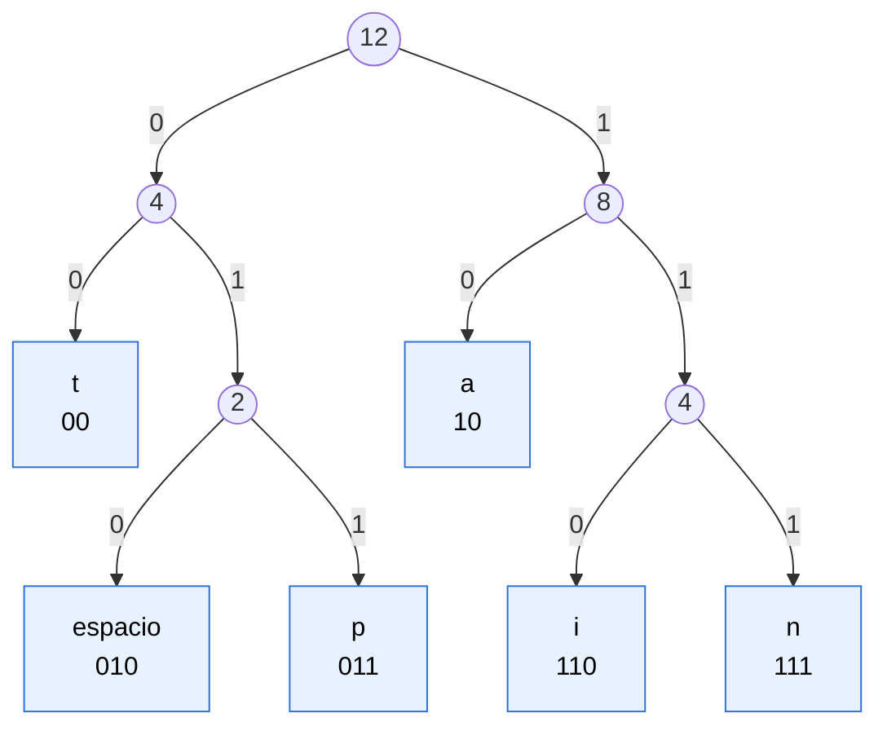

# Huffman: guía de estudio y compresor con interfaz gráfica

Guía completa para estudiar el **algoritmo de Huffman con el criterio del profesor** (el de "anita patina") y un programa en Python que comprime y descomprime archivos con ese mismo formato.

- **Qué incluye:** teoría, las reglas del profesor, una explicación detallada de cómo se **suman los árboles**, ejemplos resueltos paso a paso, el formato del archivo comprimido, una guía línea por línea del código, ejercicios con solución y una hoja de resumen.
- **Idioma:** español.
- **Estado:** el programa y todos los ejemplos de las guías están verificados con **20 pruebas automáticas** (ver [Pruebas](#pruebas)).

## Índice de las guías

| # | Documento | Para qué sirve |
| --- | --- | --- |
| 01 | [Fundamentos y reglas](docs/01-fundamentos-y-reglas.md) | Qué es Huffman, bytes y ASCII, **las 12 reglas del profesor**, convenciones (0 o 1 a la izquierda), factor de compresión. |
| 02 | [Cómo se suman los árboles](docs/02-suma-de-arboles.md) | **La parte central del ejercicio:** la receta de 6 movimientos, los tres tipos de empate, dónde se coloca cada nodo nuevo, las sumas de control y ejercicios. |
| 03 | [Compresión y descompresión](docs/03-compresion-y-descompresion.md) | Los 7 pasos del tablero, el archivo `NT \| Tree \| BS \| ZIP`, el árbol guardado en preorden y el camino inverso. |
| 04 | [Guía del código](docs/04-guia-del-codigo.md) | Cada función de `src/huffman_gui.py` explicada con trazas y ejemplos. |
| 05 | [Ejercicios y resumen](docs/05-ejercicios-y-resumen.md) | El Test III resuelto, ejercicios de compresión, descompresión y bytes, errores comunes, preguntas de repaso y la hoja de resumen. |

**Orden de estudio recomendado:** 01 → 02 → 03 → ejercicios de la 05 → 04 (si quieres entender el programa).

## Estructura del repositorio

```
huffman-guia/
├── README.md
├── .gitignore
├── docs/
│   ├── 01-fundamentos-y-reglas.md
│   ├── 02-suma-de-arboles.md
│   ├── 03-compresion-y-descompresion.md
│   ├── 04-guia-del-codigo.md
│   └── 05-ejercicios-y-resumen.md
├── src/
│   └── huffman_gui.py          # compresor / descompresor con ventana (Tkinter)
└── tests/
    └── test_huffman.py         # 20 pruebas automáticas (unittest)
```

## Resumen de un minuto

1. Cuenta las frecuencias y ordena la lista **de menor a mayor frecuencia; si empatan, por ASCII**.
2. Toma los **dos primeros**, súmalos y crea un nodo nuevo: el primero va a la **izquierda** y el segundo a la **derecha**.
3. Coloca el nodo nuevo **después de todos los que pesen lo mismo**. Repite hasta que quede un solo nodo (la raíz).
4. El código de cada carácter es el camino de la raíz a su hoja (**0 izquierda, 1 derecha**; el Test III lo invierte).
5. Pega los códigos, corta de a 8 bits y rellena con ceros **solo al final**.
6. El archivo es `NT | Tree | BS | ZIP`: `NT` = nodos internos, `Tree` = árbol en preorden (`0 0` nodo interno, `1 ASCII` hoja), `BS` = bits válidos del último byte (1 a 8) y `ZIP` = los bytes comprimidos.

Ejemplo con **"anita patina"**:

| Carácter | a | n | i | t | espacio | p |
| --- | --- | --- | --- | --- | --- | --- |
| Código | `10` | `111` | `110` | `00` | `010` | `011` |

30 bits → ZIP = `190, 36, 227, 120`, **NT = 5**, **BS = 6**, factor 4 ÷ 12 = **33,3 %**.



## Usar el programa

**Requisitos:** Python 3.8 o superior con Tkinter (viene incluido en Windows y macOS; en Linux: `sudo apt install python3-tk`).

```bash
python src/huffman_gui.py
```

- **Comprimir:** elige uno o varios archivos. Cada uno se guarda como `nombre.ext.zip` en formato `NT | Tree | BS | Zip`, y la ventana muestra el cálculo completo (tabla de frecuencias, códigos, ZIP, NT, BS y factor).
- **Descomprimir:** elige archivos Huffman con cualquier extensión (`.zip`, `.pkz`, `.huf`, …). También abre comprimidos normales (`.zip`, `.tar`, `.gz`, `.bz2`, `.xz`; y `.rar`, `.7z` si tienes 7-Zip instalado).

Usar la lógica sin ventana:

```python
import sys
sys.path.insert(0, "src")
import huffman_gui as hg

archivo, detalle = hg.comprimir("anita patina".encode())
print(detalle)
original, _ = hg.descomprimir(archivo)
print(original.decode())   # anita patina
```

## Pruebas

```bash
python -m unittest discover -s tests -v
```

Las pruebas **no necesitan la ventana** (si Tkinter no está instalado, se reemplaza por un objeto vacío). Verifican:

- Los ejemplos del tablero: "anita patina", banana, abracadabra, mississippi, casa y hola mundo, con su NT, Tree, BS y ZIP exactos.
- La ida y vuelta idéntica en casos límite: un solo símbolo, los 256 valores de byte, árboles muy profundos, texto con ñ, archivos de más de una tanda (65.536 bytes) y datos aleatorios.
- Que 500 archivos aleatorios coincidan con una implementación independiente de las reglas del profesor.
- Las sumas de control de la guía 02: raíz = largo del texto, NT = hojas − 1 y suma de los pesos internos = total de bits.
- La comprobación de archivos Huffman sin falsos positivos y la compresión de archivos reales en disco.

## Subir el repositorio a GitHub

**1. Crea el repositorio vacío** en GitHub: botón **New repository**, ponle un nombre (por ejemplo `huffman-guia`), déjalo sin README ni `.gitignore` y pulsa **Create repository**.

**2. Desde la carpeta del proyecto**, en una terminal:

```bash
git init
git add .
git commit -m "Guía de Huffman y compresor"
git branch -M main
git remote add origin https://github.com/TU-USUARIO/huffman-guia.git
git push -u origin main
```

Cambia `TU-USUARIO` por tu nombre de usuario de GitHub. Si GitHub te pide autenticación, usa tu usuario y un **token personal** (Settings → Developer settings → Personal access tokens) en lugar de la contraseña.

**Alternativa sin terminal:** en el repositorio nuevo, pulsa **uploading an existing file** y arrastra el contenido de la carpeta (`README.md`, `docs`, `src`, `tests`, `.gitignore`).

**3. Comprueba cómo se ve.** GitHub dibuja los diagramas `mermaid` y los desplegables `<details>` directamente en el navegador. Los enlaces entre documentos son relativos, así que funcionan sin cambiar nada.

**Licencia.** Si lo haces público, considera agregar un archivo `LICENSE` (por ejemplo MIT). Si es un trabajo de curso, revisa antes las reglas de tu universidad sobre publicar soluciones.
